# Backend automation candidate

This directory describes the 28 September 2026 implementation in the isolated
`feature/backend-automation-20260928` worktree. It is an opt-in local candidate,
not a released or fully accepted version of the M0–M6 roadmap.

For the reconciled 2 October state, selected Ready Block integration, completed
Vercel inventory audit and remaining priorities, start with
[current status and remaining tasks](current-status-2026-10-02.md). Older dated
acceptance rows below retain their original evidence scope.

- [Full feature roadmap guide](../plans/2026-10-03-feature-roadmap-guide.md) — readable scope, architecture, priorities, all 45 packages and the next implementation batch
- [Technical feature plan: Vercel, login, automation, secrets/logs, lifecycle, domains and AWS/GCP](../plans/2026-10-02-consolidated-feature-roadmap.md) — detailed contracts, current implementation evidence and remaining gates
- [Atomic scheduler admission and recovery](scheduler-admission.md)
- [Notification delivery, repair and uncertainty](notification-delivery.md)
- [Git delivery decision history and coverage](git-delivery-history.md)
- [Vercel account and deployment sync — first provider priority](vercel-sync.md)
- [Neon metadata connections](neon-connections.md) — encrypted scope-bound onboarding, project discovery/selection, manual sync and truthful resource reads; actual acceptance states remain explicit
- [Implementation and remaining gates](../plans/2026-09-28-backend-implementation.md)
- [Setup, migration, and recovery](operator-guide.md)
- [Disposable PostgreSQL backup/restore evidence](backup-restore.md)
- [Source connections and provider evidence](source-adapters.md)
- [Repository token replacement and recovery](source-token-replacement.md) — metadata checks, connection-version fences and uncertain-save recovery
- [Manual missed-ref recovery](missed-ref-recovery.md) — reviewed authority before source access, shared-rule evaluation and durable deduplication
- [Rejected deployment history](preflight-deployment-history.md) — atomic, effect-free registry/environment refusals and reason-aware recovery
- [Local signed Git webhook → Docker acceptance](git-automation-acceptance.md)
- [Automation boundary review](automation-review.md)
- [BuildKit → registry artifact contract](buildkit-handoff.md)
- [Immutable service-image admission](image-admission.md)
- [Real local Redis and n8n acceptance](local-deployment-acceptance.md)
- [Interrupted-worker recovery acceptance](interrupted-worker-acceptance.md)
- [Service configuration permissions](../plans/2026-09-28-environment-scope.md)
- [Durable logs and masking limits](../plans/2026-09-28-deployment-logs.md)
- [Docker service log snapshots](runtime-log-snapshots.md) — replica selection, bounded history, search, download and retention
- [Environment editing and metadata-only protected-key inventory](environment-secret-editing.md) — generation fences and supported manager capabilities
- [Offline encryption-key rotation](offline-key-rotation.md) — complete ciphertext inventory, authenticated backup, atomic rewrap and original-byte restore

## What is connected

```mermaid
flowchart LR
    Git[Git provider] -->|Signed event| Receiver[Connection webhook]
    User[App deployment button] --> Planner[Exact source and configuration]
    Receiver --> Inbox[PostgreSQL delivery and decision]
    Inbox --> Review[Rule, permission and configuration checks]
    Review --> Planner
    Planner --> Queue[Durable App job]
    Queue --> Worker[Worker with renewable claim]
    Worker --> Checkout[Checkout exact Git commit]
    Checkout --> Build[BuildKit → private OCI artifact → Crane]
    Checkout --> Image[Existing service image]
    Build --> DAG[Dependency ordered deployment]
    Image -->|Digest captured before admission| DAG
    DAG --> Runtime[Configured runtime]
    Runtime --> Observe[Readiness and service logs]
    Worker --> Logs[Redacted durable stage logs]
    Logs --> Workspace[Cooker workspace]
    Observe --> Workspace
```

The accepted standalone design preview remains separate. These changes extend
the existing React application settings, App details, import wizard, run views,
and log controls. They do not publish or replace the design prototype.

## Configured capability versus observed acceptance

| Combination | Implementation | Evidence / boundary |
| --- | --- | --- |
| Manual App → PostgreSQL queue → Docker Compose | Implemented, queue opt-in | Real Redis and four-service n8n; pinned source and service credential isolation |
| Source → BuildKit → OCI → Crane registry | Implemented, including remote mTLS | Real single-platform and multi-platform scratch image publication; separate from hosted GitHub application acceptance |
| GitHub App/PAT/public source and branch/tag rules | Implemented | Contract, real local Git ref, and PostgreSQL automation tests; hosted delivery/private-account UAT pending |
| Gitea HTTPS private source and automation | Implemented | Real Gitea 1.26.4 private source/tag/revocation checks and signed HTTPS webhook → reviewed rule → queue → healthy Docker Redis; hosted/production acceptance remains separate |
| GitLab HTTPS source, nested groups and signing/legacy hook modes | Implemented | Contract tests; real GitLab server/account acceptance pending |
| Docker service logs and observed health | Implemented | Real service logs in local App acceptance; periodic readiness behavior also tested with fixtures |
| Kubernetes readiness / service logs | Readiness implemented; log sessions unavailable | Templates carry run identity; readiness checks it and controller generation. Log streaming fails closed until immutable pod sessions exist; real cluster acceptance pending |
| ECS / Cloud Run App destinations | Existing configured subset retained | Cloud account acceptance and complete logs/recovery are M5 work |
| Vercel account/project deployment synchronization | Encrypted token connection, project selection and read-only polling implemented | Contract, real PostgreSQL and UI fixture checks; hosted account UAT pending |
| Vercel native deployment creation/promotion | Not implemented | Later Vercel slice |
| Existing operator base-domain routing | Existing Traefik/Ingress generation retained | Operator configures DNS, TLS and network reachability |
| Domain ownership, certificate lifecycle, stable tunnels | Not implemented | M4 |
| Environment promotion | Approval records only | No successful rollout claim; actual promotion dispatch remains unfinished |

The capability endpoint reports configuration availability. An available adapter
does not certify credentials, network access, workload health, or live-provider
acceptance. No-op adapters are not a successful App deployment path.
