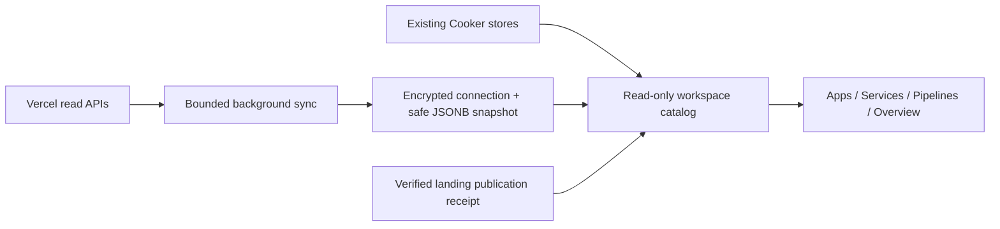

# Unified Apps, Services and provider flows

Cooker now answers what is deployed, where it is hosted, and how it arrived by
combining native Cooker records with selected Vercel snapshots. This is a
read-only workspace projection. Imported projects never enter executable App,
Pipeline, Run or job tables.

## User journey

- **Settings:** keep the encrypted connection, selected projects, pause,
  replacement and disconnect controls.
- **Cloud:** connection-level freshness and provider-wide recent activity.
- **Apps:** native apps and selected Vercel projects; Vercel cards prioritize the
  confirmed current production deployment while keeping latest activity separate.
- **Services:** components across apps, production-first Vercel filtering,
  latest previews and separately recorded native environments. The same service
  data appears inside app details.
- **Pipelines:** editable native DAGs and **Vercel-managed · Read-only** flows.
  Provider flows explain source used by deployment and deployment sent to a
  destination; they are not startup dependencies, traffic maps or executable DAGs.

An imported app uses `/apps/synced/:catalogId`; its provider flow uses
`/pipelines/synced/:catalogId`. A service deployment link includes the exact
`?deployment=` ID. Unknown deep links fail visibly instead of selecting another
release. A graph and an equivalent ordered step list explain each provider flow.

## Data boundaries

Vercel app identity is a SHA-256 projection of account/team scope, provider
account ID and project ID; renames, repository changes and token replacement do
not alter it. Overlapping selected connections produce one app. Core inventory
uses the freshest successful snapshot, with deterministic tie-breaking; optional
project and deployment observations are independently chosen by matching identity
and their own successful observation times. Deselected connections cannot enrich
the remaining catalog. Native IDs and existing execution routes remain intact.

App lists use bulk latest native deployment reads; pipeline lists use minimal
pipeline/latest-run projections. Service reads inspect recorded deploy stages,
not containers or log streams. App history is read only for its detail route.
The PostgreSQL and memory stores implement the same optional bulk interfaces.

## Authenticated read APIs

All endpoints are under `/api/v1` and use existing authentication and roles.

| Endpoint | Result |
| --- | --- |
| `GET /catalog/apps` | Combined summaries |
| `GET /catalog/apps/:id` | App, services, releases and related flow |
| `GET /catalog/services` | Components and concrete deployment context |
| `GET /catalog/pipelines` | Native summaries and provider flows |
| `GET /catalog/pipelines/:id` | Flow, app, services and history |

List results contain `items`, filtered `total`, `limit`, `offset` and `sources`.
Filtering precedes pagination. Search uses `q`; common filters are `provider`
and `management`. Services also support `appId`, `environment` and `status`.
The default limit is 50 and maximum is 100. `environment=production_first`
means current-production Vercel components plus native recorded environments;
it does not classify native environments as production by name or order.

`sources` and per-record freshness disclose unavailable or retained partial
data. Missing resources return 404 only when the matching source is available;
unavailable sources return 503. Imported capabilities never enable edit/deploy.
Native mutations continue through existing role-protected APIs.

## Production and service truth

Current production comes only from `targets.production.id`. A newer failed
preview cannot replace it. Exact production may be outside the latest 100
releases and remains selectable without increasing that history limit. Confirmed
production aliases come from the exact-deployment `/v2/deployments/{id}/aliases`
API when refreshed. Alias observations have their own time/error, merge independently
across selected connections and clear former values on a successful empty response.
Last-observed aliases remain labelled when refresh fails. Production aliases and unique
deployment URLs are separate; neither
is presumed publicly accessible. Dashboard links are verified HTTPS Vercel URLs.

Reported deployment services are deployed components sharing one provider
deployment. Project-only definitions are configured. Explicit empty ordinary
service definitions produce one Application component; inaccessible/missing
metadata produces Service details unavailable. An identity-matched owner deployment
with safe project settings can display a generic Application deployment aggregate
while explicitly stating that detailed component inventory was not reported. This
aggregate leaves `servicesKnown=false` and proves neither a single component nor
ordinary build mode; an explicit Services framework remains unavailable without
its metadata. Framework names never invent
functions, databases, queues or dependencies. Provider readiness is separate
from health: READY does not imply Cooker probed the application.

Native component runtime/environment come from its recorded deploy stage,
not a later edit of the app's intended target. Native runtime/log inspection
continues in its existing app view. Vercel inspection goes to the provider
dashboard; direct provider log ingestion is deferred.

The source Uploaded Cooker landing bundle requires a succeeded durable receipt
matching account scope, account ID, project ID and exact deployment ID. Receipt
lookup is independent of the recent-operation UI window. Artifact attribution
is attached only to that release, never another preview or an uncertain write.

## Snapshot safety and compatibility

Project/deployment enrichment uses current official v9/v13 safe typed fields:
repository/branch, production binding, service names/types/framework/runtime,
aliases, inspector links, available timestamps and Git ref/SHA. Owner responses
can contain private environment data; raw responses, env values, metadata,
credentials and logs are excluded from persistence and catalog output.

Optional fields extend existing PostgreSQL JSONB; no new migration is needed.
Old snapshots remain readable. Core failure retains the prior successful
snapshot. Optional failure retains identity-matching details with their own
old observation time and an explicit warning. Existing two-minute polling,
90-second deadline, version/lease fencing and provider cooldown remain intact.
Enrichment uses at most four concurrent requests and at most four optional reads per
selected project (project/current production/current-production aliases/latest preview).
Aliases are never read for every historical release. Core inventory pagination has
its existing separate bounds. Old snapshots without the optional alias/aggregate
fields remain readable and gain fresh observations through normal polling.

## Verification and local rollout

Implementation evidence, frozen source revision/build inputs, frontend bundle,
backend tests and live acceptance are recorded in
`/mnt/data/cooker-catalog-20261002/README.md`. Fixture browser checks and actual
PostgreSQL tests are distinct from real-account acceptance.

Local rollout preserves the existing database, encryption/auth environment,
previous backend/frontend builds and stopped rollback container. Before switching
the localhost API, active executions/publications are checked; a readiness or
preservation failure restores the previous API. Rollback stops the new owned API
and starts the retained previous one after checking active work. Never run both
on port 4644, reset the database, or replace its key during rollback.

This release does not add OAuth, provider deploy/promote/rollback/provision/env
controls, direct Vercel logs, domain changes or AWS/GCP catalog adapters. The
separately authorized landing publisher remains available. Local acceptance
does not constitute a merge, Git push or public Cooker deployment.

Official schemas checked 2 October 2026:
[Vercel OpenAPI](https://openapi.vercel.sh/),
[deployment details](https://vercel.com/docs/rest-api/deployments/get-a-deployment-by-id-or-url),
[Vercel Services](https://vercel.com/docs/services).
