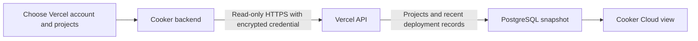

# Vercel connection and deployment synchronization

Owner direction, 30 September 2026: Vercel is the first provider integration.
Connect an existing account or team and follow its deployments in Cooker.
This is the inventory slice of the Vercel roadmap; the entire roadmap remains open.
For the separate bounded publishing action, see [Publish the Cooker landing](vercel-static-landing.md).

## Use it

1. Open **Settings → Vercel connections** as a Cooker administrator.
2. Add a connection name and a Vercel access token. Leave Team ID blank for a
   personal account, or supply the exact `team_…` ID for a team. The token must
   have access to that scope and its selected projects. Create the token in
   [Vercel account settings](https://vercel.com/account/tokens); choose the
   appropriate account/team and expiry. Enter it in Cooker, never in chat.
3. Cooker verifies the account/team before encrypting the token. Choose up to
   20 accessible projects and save. Initially no projects are selected, so
   creating a connection alone does not import everything.
4. Open **Cloud → Vercel deployments**. Refresh manually or let the server
   refresh approximately every two minutes. The browser reloads Cooker's
   stored view every 30 seconds while this page is open.
5. Filter by connection/project. Each deployment shows its provider state,
   production/preview target, timestamp, URL and available Git branch/commit.
   Import history is bounded to the latest 100 deployments per project.

Settings and Cloud show **Last discovery** counts from a successful complete
inventory read: selected, accessible and not selected, with its own observation
time. These counts apply to the saved account/team and token permissions, not all
Vercel accounts. Paused/failed synchronization retains its labelled last-known
counts. Legacy snapshots show unavailable coverage until refreshed. Changing the
selection clears the old snapshot/counts until the next successful sync.

**Manage projects & connection** performs a current read and displays accessible
and selected counts. Search filters before pages of 25 projects; selections stay
selected when their checkbox is on another page. Discovery does not automatically
select new projects. If provider pagination cannot establish complete discovery,
the read fails explicitly and no empty/partial result is presented as complete.
An unavailable discovery cannot overwrite the saved selection through this form.

For local email/password sign-in, build the frontend with
`VITE_LOCAL_AUTH_ENABLED=true` and enable the backend's local-auth settings.
The localhost preview at `http://127.0.0.1:4644/signin` uses that pairing.
Create the first local Cooker account, which receives the existing bootstrap
admin role, before opening Settings. The preview has no seeded user account.

The Vercel panel works independently of the AWS/GCP inventory feature. Safe
snapshot reads are available to authenticated Cooker users; account setup,
project discovery, token replacement, pause, refresh and disconnect require
admin access and the installation's configured MFA policy.

A token is stored only as encrypted server-side ciphertext. It is excluded
from JSON responses, cleared from the form on success/cancel, and is never
put into browser storage or a URL. Disconnection removes Cooker's credential
and snapshot; it does not revoke the token or delete anything in Vercel.
Revocation remains available in Vercel token settings.

## Operator prerequisites

Use PostgreSQL (`DATABASE_URL`) and an active `COOKER_SECRET_KEY` (base64-encoded
32-byte key). Migration **032** adds `vercel_connections`; the normal migration
path applies it. Preserve the installation's existing key and database backup.
The integration returns 503 when database/encryption are unconfigured. It does
not fall back to an in-memory or plaintext connection in a running server.

Synchronization is independent of `COOKER_JOBQUEUE_ENABLED` and the cloud
inventory flags. It needs outbound HTTPS to the fixed `api.vercel.com` origin;
no public Cooker ingress or webhook URL is required for polling. Production
installations retain Cooker's authenticated access boundary; development
admin mode remains the existing local-only development convention.

## What synchronization means

Cooker imports provider-owned records. A Vercel READY record is not a Cooker
DAG execution or proof of application-level health. The inventory API does not create,
promote, roll back, cancel, scale or delete Vercel deployments.
Vercel's own Git integration continues to own those deployments.

A failed refresh retains the last successful snapshot and its success time,
records a safe error and schedules a retry. The UI distinguishes paused,
never synced, syncing, stale and failed states. Provider rate limits honor
`Retry-After`/`X-RateLimit-Reset`; ordinary failures use bounded backoff.
Manual refresh cannot bypass a stored retry deadline.

The token is verified against the saved account/team before discovery and
refresh. Replacement tokens must retain that identity; connect a separate
record to switch accounts. Project membership is checked again on save and
refresh. A missing selected project makes the whole refresh fail; incomplete
inventory is never interpreted as deletion. Projects API pagination is
bounded at 1,000 projects/20 pages; an unprovably complete inventory fails
rather than silently omitting projects.

A PostgreSQL lease coordinates replicas. Publishing a snapshot requires the
same connection version, lease ID and an unexpired lease. Edits/disconnection
invalidate the old lease. Changing project selection clears the old-scope
snapshot and success timestamp; no stale refresh can republish it. A process
interruption allows another replica to claim after the two-minute lease
expires. Each refresh has a 90-second deadline, and snapshots commit atomically.

## Endpoints

All paths begin with `/api/v1`.

| Method and path | Purpose |
| --- | --- |
| `GET /integrations/vercel` | Safe connections, selected projects and recent deployments |
| `GET /admin/integrations/vercel/connections` | Safe administrator connection list |
| `POST /admin/integrations/vercel/connections` | Verify and encrypt `{name,token,teamId?}` |
| `PUT /admin/integrations/vercel/connections/:id` | Versioned name/token/enabled/project selection update |
| `DELETE /admin/integrations/vercel/connections/:id?version=N` | Disconnect Cooker only |
| `GET /admin/integrations/vercel/connections/:id/projects` | Current verified accessible project inventory |
| `POST /admin/integrations/vercel/connections/:id/sync` | Request a read-only refresh |

Creation/update/sync return `{connection:…}`; listing returns
`{connections:[…]}`; project discovery returns `{projects:[…]}`; disconnect
returns `{disconnected:true}`. Timestamps are RFC3339. Sync failure is reported
as the returned connection's `syncError`; its previous snapshot stays visible.
Conflict/in-flight/backoff returns 409; invalid identity/selection returns 422.

## Acceptance and limits

Provider transport tests use current official API schemas, mocked HTTPS
responses and synthetic tokens. They cover pagination, team scope, errors,
rate limits, body/time limits, redirects, unsafe URLs and credential redaction.
Service/store tests cover explicit selection, identity-preserving replacement,
failure retention/backoff, background refresh, lease expiry and stale edits.
Actual PostgreSQL tests cover encrypted persistence, restart reads and stale
snapshot fencing. Registered HTTP routes test real local-token authentication,
viewer restrictions and configured MFA. UI/browser tests are deterministic
fixtures, including mobile actions and accessibility.

Evidence is kept in `/mnt/data/cooker-vercel-validation-20260930/` and
`/mnt/data/cooker-vercel-frontend-evidence-20260930/`. No real Vercel token was
provided to this candidate, so hosted account/project synchronization remains
an explicit UAT gate. The managed Vercel connector's credentials cannot be
exported or silently reused by Cooker. Its empty team response plus a team-ID
requirement on project listing did not establish personal-account inventory.

## Next roadmap slices

1. **Vercel A — connection and read-only synchronization:** this implementation.
   Next acceptance: connect the owner's selected account/team in the secure
   Cooker form, compare existing production/preview records against Vercel,
   observe an externally created deployment on the next poll, then test pause,
   token expiry/replacement and reconnect. Do not create a deployment merely
   to claim this gate without explicit scoped authorization.
2. **Vercel B — OAuth onboarding:** register a Cooker Vercel integration/app,
   configure its client credentials and redirect URI, add state/PKCE as
   appropriate to the selected official flow, validate code exchange and
   installation/team ownership, then encrypt obtained credentials. OAuth client
   registration is required; an access-token form is not labeled OAuth.
3. **Vercel C — reviewed deployment controls:** choose one automation owner per
   project, bind immutable source/native build artifacts, store provider
   deployment IDs and add policy-gated deploy/promotion/rollback reconciliation.
   Certify supported build/runtime log access and account permissions separately.
4. Continue hosted Git acceptance and the existing M1 release gaps; then domain/
   tunnel management and AWS/GCP operations. These remain open and are not
   implied complete by the Vercel import panel.

## Provider references, checked 30 September 2026

- [REST API authentication and team scope](https://vercel.com/docs/rest-api)
- [Projects listing, GET /v10/projects](https://vercel.com/docs/rest-api/projects/retrieve-a-list-of-projects)
- [Deployments listing, GET /v7/deployments](https://vercel.com/docs/rest-api/deployments/list-deployments)
- [Current official OpenAPI schemas](https://openapi.vercel.sh/)
- [Vercel API integration registration and token exchange](https://vercel.com/docs/integrations/create-integration/vercel-api-integrations)

Vercel Connect is a separate way for Vercel applications to obtain third-party
credentials; it is not Cooker's Vercel account connection flow. Vercel hosting
instructions for Cooker also remain separate from this product integration.

## Optional project and deployment details

The stored inventory can include a safe detail projection from Vercel's
[official API schema](https://openapi.vercel.sh/), checked 2 October 2026:

- Project repository name, production branch and exact
  `targets.production.id`, plus provider-defined services when returned.
- Current production and latest preview deployment service definitions,
  validated HTTPS aliases/inspector links and build/ready timestamps.
- Each detail observation has its own `observedAt` and optional safe `error`.
  A missing `services` field means unknown (`servicesKnown: false`), while an
  explicit empty array means the provider reported no service definitions.
  Cooker does not synthesize a web service from the project name/framework.

Current production comes from the project's explicit production target, never
from the newest READY deployment. Its record is stored under
`project.details.productionDeployment`, so it remains available when outside
the latest 100 history records. That nested record does not expand the recent
history window. A failed detail lookup retains only an observation for the
same project/deployment identity. Its old observation time remains visible;
a first lookup failure has no successful observation time.

After core identity/project/history reads succeed, detail reads run with at
most four concurrent requests per connection. Each of at most 20 selected
projects requires at most three reads: project, exact production and newest
preview (a shared deployment is read once). They share the existing 90-second
sync deadline and the same version/lease fence. Rate-limit or Retry-After
responses cancel remaining optional reads and persist the connection cooldown;
manual refresh cannot bypass it. Core inventory can still be saved when optional
details fail. A core failure continues to retain the entire previous snapshot.

Only explicitly typed safe fields are decoded into the saved projection.
Environment values, raw metadata, build settings, logs, credentials and raw
provider error bodies are excluded. Old JSONB snapshots without details remain
readable; no new migration is required. These observations describe provider
configuration/status, not a Cooker DAG or a claim of service-level runtime health.
