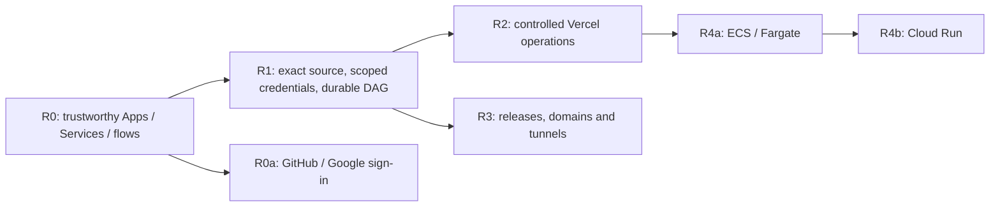
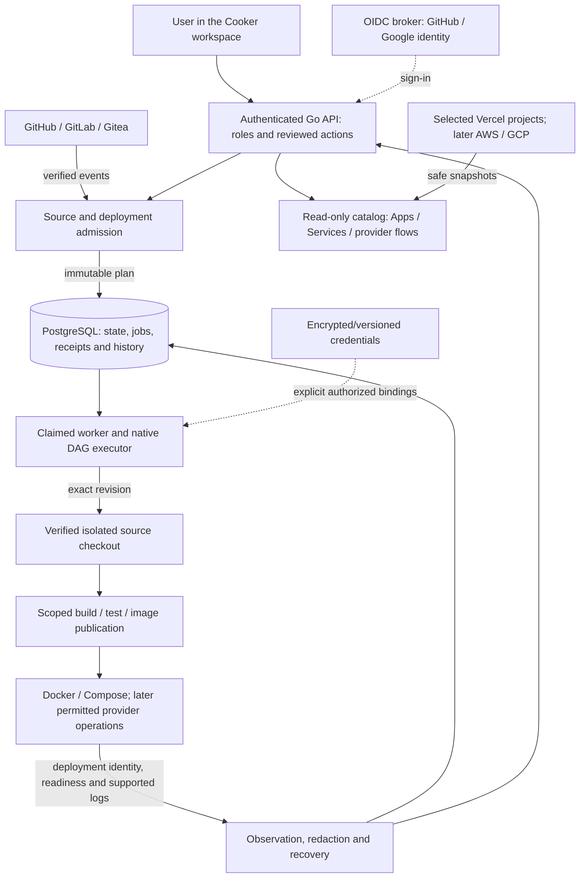

# Cooker — consolidated feature and delivery plan

> Latest checked checkpoint: the 5 October 08:05 UTC local manual native journey passed. [Acceptance](/mnt/data/cooker-roadmap-20261002/environment-refusal-history-20261004/continuation-20261004/NATIVE-DAG-JOURNEY-ACCEPTANCE.md); [next automatic Git preparation](/mnt/data/cooker-roadmap-20261002/environment-refusal-history-20261004/continuation-20261004/native-gitea-automation-preparation-v1/CONTRACT.md). Full-roadmap completion remains open.


**Plan date:** 2 October 2026, Asia/Bangkok; delivery status reconciled 5 October (Asia/Bangkok); latest official App/runtime/restart checks recorded 5 October UTC.  
**Audience:** self-hosted users and small teams.  
**Direction:** dependable Git-to-deploy, with Vercel as the first provider integration.  
**Status:** full delivery scope retained; local implementation is in progress under the subsequent “Let finish the full plan” goal. Future tasks and code presence are not acceptance or release evidence.

For the readable feature-by-feature plan, architecture, next implementation batch
and completion gates, start with the [3 October roadmap guide](2026-10-03-feature-roadmap-guide.md).
This technical plan retains all 45 packages, 20 gates and 12 invariants.

**3 October reconciliation:** the compatible native/manual App workers now have
named actual local checkout/build/push/Docker execution and revocation evidence.
These source-built workers do not establish official static-server dispatch or
owner activation. LOG-01's bounded Docker snapshot backend and controls passed
affected checks, independent review and isolated real Docker/official HTTP/browser
acceptance; coherent owner activation and the full release journey remain open.
Configuration now has scoped actual Compose/native and Dockerfile API/UI acceptance.
Offline rotation has private-input CLI, database restart, named COMMIT-uncertainty,
genuine accepted-plan resolution and full-filesystem backup-refusal evidence;
The later eight-case Dockerfile campaign separately proves source-built current/fallback execution and two selected rotation-to-execution cases on older exact inputs. Official server/combined rollout, remaining crash/fsync and broad executable recovery remain open.
The token-replacement part of GIT-05 now passed scoped affected Go, actual PostgreSQL and frontend/browser checks. Its retained final binary has not been started as a server. Hosted replacement/revocation, real combined API/UI and bounded missed-event recovery remain open. See the [replacement contract](../backend/source-token-replacement.md) and [local handoff](/mnt/data/cooker-roadmap-20261002/source-credential-replacement-20261003/README.md). Current and limited backport ciphertext readers also passed fresh-process checks; this is reader compatibility, not executable/runtime recovery. A tracing recovery preparation was rejected by automatic approval review; no tracing test ran or bypass was attempted.
Manual App missed-ref checks now verify current reviewed metadata and normalized plan hash before private source access. Final875 passed 1,366 affected race entries, four actual PostgreSQL entries, two scoped vets and static compilation; the binary was not started. The real shared inbox/App producer proves dedupe/fan-out with pending unclaimed jobs and contract source fixtures. [Exact recovery handoff](/mnt/data/cooker-roadmap-20261002/missed-ref-recovery-20261003/README.md). The [actual eight-case runtime handoff](/mnt/data/cooker-roadmap-20261002/dockerfile-environment-bindings/runtime-20261003/RUNTIME-HANDOFF-v5.md) remains separate older-source evidence: four deployments and four zero-effect generation refusals. Those older frozen refusals have business failure runs but no deployment-history rows. The newer [atomic history repair](/mnt/data/cooker-roadmap-20261002/environment-refusal-history-20261004/README.md) passed 1,610 affected default race entries (eight optional skips), 56 actual PostgreSQL entries and scoped vet/static compilation. Confirmed metadata mismatch produces one rejected marker; unavailable reads remain uncertain. Two new current selected/empty cases passed genuine PostgreSQL App admission and fresh OS workers: one exact rejected history row per case, failed/unstarted business run, completed queue handler, zero execution/private reads, original receipts and unchanged outcome under completed lifecycle projection. That projection does not prove process-loss recovery. Reason-aware executable fallback and combined official acceptance remain separate. No full GIT-05, SEC-01, R1 or program acceptance is claimed.
The running owner build is unchanged. Earlier next-step statements below retain
their dated scope; the current next batch is the guide's section 11.

## Plan at a glance

**Build for self-hosted users and small teams.** Keep the accepted frontend and
make the backend dependable. Vercel is the first hosting integration; GitHub is
the first hosted source acceptance campaign. The full scope is 45 work packages,
with separate verification, documentation and release gates.

| Priority | What users gain | Scope | Completion evidence |
| --- | --- | --- | --- |
| R0 | See what is deployed and where | Apps, Services, production-first Vercel flows/history, accurate aliases, coverage and freshness | Selected-project comparison plus actual signed-in navigation and rollback rehearsal |
| R0a, alongside R0 | Sign in with GitHub or Google | Existing Keycloak broker, safe callbacks, roles and recovery | Real provider round trips, with local administrator access retained |
| R1 | Deploy an exact branch or tag through a real DAG | GitHub/GitLab/Gitea triggers, configuration/credentials, registry authority, logs, queue recovery and notifications | Source → reviewed immutable plan → real build/runtime → readiness/logs, including failure and restart cases |
| R2 | Connect and control permitted Vercel projects | OAuth, refresh events, existing landing update, explicit project adoption, native Vercel stage, supported logs/promote/rollback/environment edits | Exact project/deployment identity and reconciled operations, without competing deployment owners |
| R3 | Manage releases and application addresses | Promotion/rollback, supported canaries, custom/operator domains, TLS and tunnels | Verified ownership, routing, renewal/reconnect and recovery on scoped resources |
| R4 | Use the same workspace across more hosting providers | Selected ECS/Fargate first, selected Cloud Run next | Separate account-scoped catalog, deployment, logs, access and recovery acceptance per provider |

**Why this order:** accurate inventory establishes trust; immutable source,
credentials and durable execution establish safe deployment. Vercel operations
reuse those foundations. Domains and broader clouds then build on known service
and release identities. Provider registrations and setup can proceed alongside
local engineering without making local Docker acceptance depend on OAuth.

**Current boundary:** JSON readiness and database health on localhost4644 were
rechecked on 3 October at 02:47 UTC (09:47 ICT). The latest
recorded read-only audit matched all 13 selected projects in the connected Vercel
team to 13 apps and 13 flows. It does not cover every account/team or automatically
select new projects. Coverage, delivery auditing, notification status and external
secret-version changes were activated together on localhost4644 at 16:21 UTC.
Quiescent application rollback and reactivation passed. Subsequent polling recorded
13 accessible and 13 selected projects with zero sync failures. Real GitHub/Google
login and the signed-in owner journey are still open.

**Next engineering batch:** complete real workspace acceptance, Docker log
snapshot controls and credential/key-rotation work, while closing the genuinely
remaining official-server, interruption/cancellation and coherent local
acceptance gaps for exact-source DAGs and scoped registry authority. Compatible
fallback startup and named dedicated-worker execution are now locally verified;
full executable upgrade/rollback remains open. Two named
after-runtime worker-loss cases now pass locally: native DAG after Docker
readiness, and manual App after its terminal result but before queue completion.
The original older workers have now failed bounded compatibility probes; their
read-compatible backport is also unsuitable for execution. Preserve modern
accepted jobs and validate a fallback retaining their source, credential and
history contracts. The bounded App rejection-history repair is locally verified and independently
reviewed.
Actual owned PostgreSQL and new-worker tests now show one typed rejected attempt
persisted with its failed run; a child exit before queue acknowledgement preserves
that business failure without another deployment. Malformed-envelope and
missing-observation-capability recovery paths now fail closed. This covers
registry preflight; other rejection reasons remain separate.

Read projection and UI acceptance are separately verified: rejected attempts stay
in history while existing native runtime/service/log information remains visible;
failed history reads show unavailable rather than an empty list. Both frontend
build profiles, scoped lint and seven history browser fixtures passed. Native and
manual App runtime, private Basic FROM, generation-bound logs and prior approval
and header repairs retain their own evidence scopes. Complete the real workspace
journey alongside this work before enabling broader provider writes. Every
remaining milestone criterion is retained; this batch is not the whole roadmap.

### Where each requested feature belongs

| Your request | Planned user experience | Work packages |
| --- | --- | --- |
| See my Vercel projects inside Cooker | Select accessible projects; find each in Apps, Services and its read-only flow; distinguish production from preview | CAT-01–05 |
| GitHub and Google login | Sign in through the configured broker and return to the intended workspace page, with explicit roles | AUTH-01–04 |
| GitHub, GitLab and Gitea webhooks; pick a branch or tag | Connect a repository, review a typed branch/tag rule, choose automatic or approval-required deployment and inspect every delivery decision | GIT-01–05 |
| A real deployment DAG | Build/test/push/deploy the accepted source through an authored native pipeline; explain arrows and show the same sequence in a text list | GIT-03, REL-01–03 |
| Readable configuration and hidden credentials | Edit ordinary values, bind protected keys to specific services, select permitted registry credentials and rotate versions safely | SEC-01–05 |
| Logs for each service | Select a concrete deployed service/container or supported provider release; inspect bounded, redacted logs with clear unavailable states | LOG-01–02, SEC-05, VRC-06, AWS-02, GCP-02 |
| Vercel as the first integration | Keep read-only sync; add easier connection, controlled existing-project updates and a separately adopted native deployment stage | VRC-01–08 |
| Promotion, rollback and deployment recovery | Review an exact artifact/release, observe the actual operation, and reconcile failures or uncertain outcomes | REL-01–03, VRC-07, LIFE-01–03 |
| Domains or an address without buying my own domain | Use a provider address, operator subdomain, verified custom domain or configured tunnel, with routing/TLS/access status | DOM-01–02, TUN-01–02 |
| AWS and GCP ecosystem support | Start with selected ECS/Fargate services, then selected Cloud Run services; extend the same catalog and operation history | AWS-01–03, GCP-01–03 |
| A realistic n8n example | Deploy PostgreSQL, Redis, n8n main and a worker; inspect their identities/logs and prove queued work actually runs | JOURNEY-N8N; R1/R3 acceptance |
| Preserve Cooker branding and usable explanations | Retain Ready Block, brackets, Open Workbench, both themes and the accepted pages; document the new backend tasks in the existing Documentation | CAT-04 and all documentation/UI gates |

Additional Git/hosting adapters use the same contracts after the named providers
pass acceptance. “And more” is an extension direction, not a claim that every
provider is supported in the first release.

## 1. What we are building

Cooker should let a team connect its source and hosting providers, understand what is deployed, and run a reviewed deployment with a traceable result. A user should be able to answer:

1. What apps and services do I have, and who manages them?
2. Which source revision and configuration produced this deployment?
3. Where is it running, and what address reaches it?
4. What happened during deployment, and what are the services doing now?
5. Can I safely deploy, promote or return to a previous application version?

Preserve the accepted landing, login, documentation and workspace layout, Open Workbench illustration, Ready Block mark, bracket identity, charcoal/ember and Paper themes. Work now centers on backend behavior and focused UI connections. Developer material belongs in Documentation. Open real Vercel projects in the actual workspace when demonstrating the integration; separate fixture examples remain labelled.

Three kinds of identity remain distinct:

| Connection | Purpose | What it does not grant |
| --- | --- | --- |
| GitHub / Google sign-in | Authenticate a Cooker user through the existing OIDC broker | Repository access or Vercel deployment authority |
| GitHub / GitLab / Gitea source connection | Read permitted repositories and authenticate webhook deliveries | Administrative access to Cooker or unrelated hosting accounts |
| Vercel hosting connection | Observe selected account/team projects; later explicitly permitted operations | Ownership of every accessible project or an editable imported DAG |

## 2. Reconciled starting point

**Current execution record, 2 October 2026:** the retained local stack is running.
At 16:21 UTC, the combined API was activated, rolled back to the retained R0
application and reactivated; all three JSON `/health/ready` checks and database
checks passed. The prior planning-only
observation of stopped containers is historical and preserved in the
[planning evidence](/mnt/data/cooker-feature-plan-20261002/README.md).

The running frozen build contains exact-production alias observations, Application
deployment aggregates, scoped project coverage, atomic schedule admission,
prospective webhook auditing, durable notification status and immutable secret
versions. Active authored-DAG source and registry-authority edits are excluded.
The prior API/frontend build and existing database/encryption configuration are
retained. No public provider operation was performed.

The read-only provider audit at 14:05 UTC found **13 accessible, 13 selected,
13 catalog apps and 13 provider flows** in the connected team. All 13 current
production alias sets matched the dedicated provider endpoint. Its 14 production
component rows comprise two reported services, one publication-backed Website and
11 Application deployment aggregates. Health remains unknown. Other account/team
scopes were not audited, and new projects require explicit selection.

Current official API/upstream review cannot establish ordinary single-service mode
from a missing service array or an ordinary/null framework. The bounded CAT-01
improvement explains the owner-observed Application deployment as an aggregate,
explicitly leaving detailed inventory unknown. Strict ordinary-build proof remains
open; the original acceptance gate is not weakened.

The earlier R0 local campaign passed 1,872 Go tests/subtests across 59 packages,
238 provider/catalog race cases, 271 frontend unit tests, TypeScript/build,
scoped lint and 10 catalog browser fixture cases. All 71 served production assets
matched the build. These checks do not establish signed-in owner acceptance:
browser security policy blocked automated access to the live tab, and the manual
walkthrough remains pending. A fixture browser is separate evidence.

A requirement audit tracks **45 packages, 20 acceptance/delivery gates and
12 invariants**. Full completion is not claimed. Current source/evidence, history
and notification work, remaining inputs and rollback are tracked in the
[execution record](/mnt/data/cooker-roadmap-20261002/README.md) and
[requirement ledger](/mnt/data/cooker-roadmap-20261002/roadmap-audit/README.md).

The primary checkout is clean `develop` at `949d4a964abec603c9b0b82f6f8d8b7f9f23d73e`, checked for this plan without a remote fetch. Pending backend/frontend work remains in `Cooker-backend` on `feature/backend-automation-20260928`; design source remains in `Cooker-landing`.

**Later local progress, 2 October:** coverage presentation, prospective webhook
audit migration036, notification migration035 and immutable secret versions have
been implemented and checked in frozen local sources. The coherent combined
backend passed 2,047 default Go cases/subtests in 63 packages, with 21 optional
fixture cases skipped, and 80 selected actual-PostgreSQL/race cases. Independent
provider-adapter tests used SDK fakes and loopback HTTP only. These newer changes
were subsequently rolled out with a 269-file frontend source freeze. This frontend
passed 273 unit tests, 39 combined owned browser fixtures, 11 local-auth fixtures,
TypeScript/build and scoped lint. All 72 current files and 141 retained hashed
assets matched HTTP bytes. The backend tests retain their original verification
time; they were not rerun for the rollout. Resource counts and auth/encryption
configuration remained unchanged through rollback/reapplication. A private
backup's archive structure was checked; no database restore was performed.
Signed-in acceptance, full process-loss/upgrade and milestone-specific live
provider checks remain open. Exact scopes and manifests are in the execution
record rather than being treated as a release.

**Later isolated engineering, 3 October ICT:** the immutable source-worker
boundary passed 916 race cases/subtests. The durable PostgreSQL lifecycle
projection passed 77 owned PostgreSQL/race cases and a 953-case affected race
campaign with seven existing optional cases skipped; a fresh SQL/queue instance
models reconstruction, without claiming a
whole-process restart. Scoped Docker/Compose registry transport passed 42 fake-CLI
and credential-helper cases. These are separate frozen inputs, not one combined
release. The initial server/handler source-wiring campaign had an approval-route
failure; that historical freeze is retained. The later coherent campaign below
passed the current routing/source cases. Native registry execution passed 861 affected fixture/race
cases, with a post-check missing-evidence guard still required. Complete
App wiring and atomic admission fencing were still open in those component
freezes; the later coherent verification below supersedes that bounded status.
Real source-to-image/runtime and local rollout remain open. See the dated
execution record; the running owner build is unchanged by these edits.

| Feature discussed | Candidate implementation | Remaining work |
| --- | --- | --- |
| Vercel account sync | Encrypted token connection, selected projects, polling, history, failure recovery, Settings/Cloud coverage/pagination locally rolled out | Signed-in acceptance, easier onboarding, optional event-driven refresh |
| Vercel projects in Apps/Services/Pipelines | Read-only catalog/flow/history; aggregate Application explanation; exact-production aliases locally verified; local rollback rehearsed | Strict ordinary-build evidence and live navigation/roles acceptance |
| Native DAG deployments | Authored DAG editor, dependency explanations, reviewed App queue, immutable artifacts and Docker deployment | Hosted source-to-runtime proof, additional crash/cancellation boundaries, promotion/rollback |
| GitHub/GitLab/Gitea auto-deploy | Connections, branch/tag rules, authenticated admission, durable delivery decisions and jobs; prospective audit/browser locally rolled out | Hosted GitHub and real GitLab acceptance; coherent official-server authored-DAG execution and owner delivery-browser acceptance |
| Configuration and credentials | Plain configuration, masked secret editing, generation checks and Compose/native/Dockerfile bindings have scoped API/UI checks; offline rotation and per-App/native registry authority have named local acceptance | Remaining worker/runtime/fallback and crash/fsync recovery, live external version/IAM/retention, current877 official deployment/log integration plus hosted replacement/revocation and coherent owner rollout; old872 and current877 official metadata HTTP/UI have named local acceptance |
| Per-service logs | Durable masked stage logs and exact-container Docker streams; bounded snapshot API and replica/time/search/download controls passed isolated real Docker/official HTTP/browser checks and independent review | Coherent owner activation and full release journey; immutable Kubernetes sessions and provider log adapters |
| GitHub/Google login | Provider buttons and allowlisted Keycloak broker flow with setup instructions | OAuth registrations, running broker, live callbacks/account/role/MFA acceptance |
| Landing publication | Existing landing was published to a dedicated Vercel project | Reviewed update of that same project with selected branding; current publisher creates a new project |
| Domains and tunnel addresses | Existing operator base-domain routing and provider addresses | Ownership verification, DNS/TLS lifecycle and persistent tunnel management |
| AWS/GCP ecosystems | Existing configured deployment subsets | Complete catalog, readiness, logs, addresses, reconciliation and real-account acceptance |

Source: [current status](../backend/current-status-2026-10-02.md), [implementation record](2026-09-28-backend-implementation.md), [catalog contract](../backend/unified-catalog.md) and [social sign-in setup](../user-guide/operations/social-sign-in.md). Older September statements about an unconnected Vercel account are historical within the audited team scope. No full-roadmap completion is claimed.

**Current coherent integration, 3 October ICT (2 October, 19:25 UTC):**
required App/native registry preflight and shared queue-pool admission hooks are
integrated in a frozen 807-file backend. It passed 2,466 race test cases across
64 packages, default/integration vet, and a static production build. The immediately
preceding 806-file freeze passed actual PostgreSQL profiles: 58 registry/App
producer cases, 31 native automation/source cases, and 77 lifecycle cases. The two
subsequent file changes only guard retained-canary promotion; their default
regressions passed, but a final-source PostgreSQL rerun is not claimed. An
independent negative fixture reproduced manual and automatic promotion on an
unsupported transport; both now reject before the transition while retaining
operator abort of an existing split. Exact manifests and limits are in the
[coherent integration record](/mnt/data/cooker-roadmap-20261002/coherent-source-registry/README.md).
These tests are not actual source-to-OCI/Docker, whole-process restart, private
registry runtime or signed-in owner acceptance. Frontend source/registry controls
were checked in a separate frozen validation campaign. This candidate is outside
the running owner build; all full work-package gates remain open.

**Later UI verification, 3 October ICT (2 October, 19:44 UTC):** source/ref and
registry selection, App conflict recovery, run source receipts and native Git rule
review/history passed 311 frontend unit tests and 38 Chromium fixture cases.
TypeScript/builds and scoped lint passed, with verified identical production
inputs after a fixture-only selector repair. Narrow layouts, keyboard access,
permissions and both themes were checked. These fixtures do not submit a real
webhook or deployment. A separate approval-stage review found role, quorum and
stale-state presentation gaps. Their focused frontend repair subsequently passed
44 policy tests and 24 Chromium fixture cases, zero-warning scoped lint and both
TypeScript/build profiles. Prior 38 browser cases were not rerun. These checks
cover retained gates, roles, quorum wording, note retention and response fences;
the full RunView HUD still crowds at 390px. See the
[approval UI handoff](/mnt/data/cooker-roadmap-20261002/stage-approval-ui/frozen-v3/README.md).
The capabilities response was aligned with scoped transport support and passed
343 affected backend race cases. The approval-stage backend now preserves the
first terminal decision and serializes votes; affected checks and an owned
PostgreSQL concurrency fixture passed. This does not establish recovery after
interruption between final-vote persistence and gate resolution, or safe errors
from the earlier run lookup. These remain separate, bounded deltas to
the earlier full-backend source freeze.
See the [native UI handoff](/mnt/data/cooker-roadmap-20261002/authored-triggers/frontend-ui/frozen-v2/README.md).

**Genuine native runtime, 3 October ICT (2 October, 19:58 UTC):** an owned local
Git commit passed the actual native automation and PostgreSQL admission path,
BuildKit OCI build, authenticated Crane publication, Docker digest pull, health
check and matching container output. Three receipt retries after grant revocation
reused the original result with no new preparation or runtime effects. The
hosted identity/event and authorization callback were fixtures. This scratch
campaign does not prove hosted GitHub, App runtime APIs, private base-image pulls
or killed/restarted processes. Its exact inputs and cleaned resources are in the
[native runtime handoff](/mnt/data/cooker-roadmap-20261002/registry-authority/native-runtime/HANDOFF.md).

The later combined 811-file source was frozen and built for local review; its
affected checks retain their individual execution boundaries. It has not replaced
the owner UAT build. JSON/database readiness on that existing build passed again
at 20:03 UTC on 2 October. Focused stage-approval frontend acceptance passed at
20:16 UTC, separately from the backend/runtime campaigns. All original release
criteria still apply.

**Approval repairs verified, 3 October ICT (2 October, 20:51 UTC):** executable
negatives reproduced the final-vote interruption, earlier run-lookup error leaks,
legacy resolver/vote corruption and stale rejection responses. Final votes now
resolve atomically; legacy quorum recovery admits no extra vote or invented
resolver. Recovery and rejection return actual stored metadata. Safe run lookups
retain ownership404 and known error semantics. The combined affected campaign
passed 1,320 race cases, both vet profiles and static build; a test-only memory
overlay passed 76 cases. Actual owned PostgreSQL passed 32 cases, including child
exit after final-vote commit, commit/cancellation rollback and exact Get/List
closure. The preceding full library campaign retains its 2,504-case scope;
these later changes are not a claimed full rerun. See the
[approval repair evidence](/mnt/data/cooker-roadmap-20261002/coherent-source-registry/stage-approval/atomic-resolution-20261003/README.md).

**Genuine manual App runtime, 3 October ICT:** real local Git, manual durable
EnqueueIntent, App worker, BuildKit, authenticated Crane and Docker completed
one build/push/deployment. RuntimeService Status/Probe and exact-container
redacted logs passed; secret rotation denied a new historical log session before
opening it. Current App target/prefix edits could not redirect observation, and
three reopened receipt retries after grant revocation caused no new effects.
The strict persistence assertion first found temporary checkout Context in the
saved graph; the cloned ReviewOnly graph now scrubs it while retaining execution
inputs. Its positive
[App acceptance record](/mnt/data/cooker-roadmap-20261002/registry-authority/app-runtime/trial-bbae9ee4-c185-4842-a9a3-425efea14f54/acceptance.json)
and label-verified cleanup are retained. This is a scratch/manual fixture with
hosted identity/source metadata fixtures, not hosted Git, automatic Dockerfile
App triggers, private FROM or whole-worker restart acceptance. The owner build
remains unchanged, with JSON/database readiness rechecked at 20:58 UTC.

**Private base and fresh worker checks, 3 October ICT (2 October, 21:31 UTC):**
three actual private-FROM cases passed: anonymous denial despite an unrelated
same-host connection, an authorized native build and an authorized manual App
build. The latter two proved real BuildKit Credentials use, private base-layer
fetch/content and matching running container identity. This is Basic
authentication on an owned HTTP authority with a literal digest in accepted
source; other registry transports and general mutable-FROM policy remain open.
See the [private-base evidence and limits](/mnt/data/cooker-roadmap-20261002/registry-authority/private-base/README.md).

Separately, two different OS workers claimed actual pending PostgreSQL jobs
after versioned registry grants were revoked. Native and App runs failed before
checkout, secret resolution, build, push or deploy. Accepted source and receipts
stayed unchanged. App queue completion records handled rejection, not deployment
success. Its zero deployment-history rows are an explicit product gap; the next
repair must persist a failed attempt with the failed run without inventing an
artifact. See the [fresh-worker handoff](/mnt/data/cooker-roadmap-20261002/registry-authority/fresh-worker-revocation/HANDOFF.md).
Their separate freezes passed 146 scoped and 826 service race cases respectively;
opt-in skips and cleanup are recorded. A combined 817-file source passed
integration vet and static build, producing unchanged production binary bytes.
This [combined verification](/mnt/data/cooker-roadmap-20261002/registry-authority/r1-runtime-combined-20261003/verification.json)
does not claim a combined runtime or full-suite rerun.

The previously observed RunView header overlap was reproduced and repaired.
Sixteen layout fixtures at 320/390/768/1440px in both themes and 24 approval
fixtures passed, with both TypeScript/build profiles and scoped lint. Graph and
console density, other App views and owner walkthrough remain separate. See the
[header layout verification](/mnt/data/cooker-roadmap-20261002/run-hud-layout/after-v1/verification.json).
The running owner build has not changed; JSON/database readiness passed at
21:28 UTC. All full packages and release gates remain unaccepted.

**App rejection history and observation, 3 October ICT (2 October, 22:15 UTC):**
the earlier zero-row App rejection remains a reproduced historical gap. The new
atomic capability records a typed `rejected`/failed identity-only attempt together
with its failed run under the actual immutable job/claim fence. Actual owned
PostgreSQL and different OS child checks passed, including storage failures,
concurrent/reopened reads, timestamp precision and loss of acknowledgement after
commit. The final backend repair passed independent review, 1,386 affected race cases
across seven packages, integration vet and static build. Four actual PostgreSQL
profiles passed 65 case entries on v6; final v7 changes only the generic memory
callback and its wrapper test, with exact relevant input parity retained. The
common profile's guarded reader skip is resolved by its separately executed
named fixture; no whole-v7 PostgreSQL rerun is claimed.

A separate read projection preserves the latest attempt in history and selects
only non-rejected attempts for native service/log observation. Ordinary failed,
needs-attention, Compose and unknown legacy kinds remain eligible; no successful
runtime or health is inferred. The exact PostgreSQL selection test passed on its
separate correctly named owned fixture. Safe App history/rollback read errors
passed scoped handler checks. Seven intercepted-API browser fixtures passed in
explicitly asserted dark/Paper themes, including unavailable/empty distinction,
retry, stale rows and late-response protection. Both TypeScript/build profiles
and zero-warning lint passed. See the
[read and history UI handoff](/mnt/data/cooker-roadmap-20261002/registry-authority/app-preflight-observation/README.md).
These tests do not replace owner, hosted-source, after-runtime process-loss,
upgrade or full release gates. Owner localhost4644 remains the prior image.

Final seven history browser cases were strengthened after two additional
negatives reproduced concurrent App/history read failures. Independent settlement
now preserves the history warning and displays a fixed App-details warning;
retry clears both. Both auth-profile builds and scoped lint passed. The exact
[atomic repair handoff](/mnt/data/cooker-roadmap-20261002/registry-authority/app-preflight-history/HANDOFF.md)
and [final UI checks](/mnt/data/cooker-roadmap-20261002/registry-authority/app-preflight-observation/frontend-v4-verification.json)
retain all previous failures and immutable inputs. Older builds can parse the new
history kind but do not know to exclude rejected attempts from runtime selection.
Include that downgrade behavior in local rollback acceptance before activation;
do not discard immutable failed history to conceal compatibility differences.

**Typed-history rollback readers, 3 October ICT (2 October, 23:00 UTC):** actual
PostgreSQL tests reproduced the older build's semantic failure in six scenarios:
it hid recorded services and followed a rejected attempt for log configuration.
A compatibility source based on the exact retained owner build, with five read
files backported, passed the unchanged checks. New/compatible-old readers also
passed after a real owned PostgreSQL restart; all application, history, queue and
migration rows remained unchanged. Latest failures stay visible while runtime
context excludes only the typed no-effect rejection. See the
[cross-version read handoff](/mnt/data/cooker-roadmap-20261002/registry-authority/typed-history-rollback/README.md).
This is read compatibility only. Older workers' handling of modern pending jobs,
in-flight upgrade, schema reversal, owner restoration and activation remain open;
the isolated compatibility binary is not an accepted executable fallback.

**Named worker-loss checks, 3 October ICT (2 October, 23:37 UTC):** the native
fixture now kills a real claimed worker after Git checkout, BuildKit build,
authenticated push, Docker digest pull and readiness. A different process
recovers the expired lease without repeating those effects. It retains the exact
verified checkout timestamp, accepted source and stage evidence; stale writes
are fenced and the next job remains blocked until explicit inspection resolution.
The separate manual App case kills its worker after successful run/history
persistence but before queue completion. Recovery honestly records attention,
preserves the same deployed runtime and performs no second deployment.

The native check reproduced two gaps before its final pass: an immediate
heartbeat could precede creation of the admitted run view, and checkout evidence
was only held in memory until the final result write. The repair tolerates only
a structurally valid native pending snapshot after a fenced missing-row heartbeat;
execution still checks current authority. It persists verified source through a
claim-fenced, source-only write before stages start. Missing capability or failed
persistence stops stages with a fixed public error and removes temporary source.
Actual PostgreSQL tests cover stale/incorrect claims, terminal states, concurrent
progress/heartbeat, exact timestamp reopening, skipped/rewritten writes and
transaction failures.

The combined 843-file candidate passed 1,501 affected race entries across eight
packages, with eight existing optional cases skipped, default/integration scoped
vet and a static production build. The named recorder profile passed 22 actual
PostgreSQL entries without skips. Runtime campaigns retain their separate exact
freezes; this is not a combined full-runtime or whole-backend/UI rerun. The owner
localhost build is unchanged and its JSON/database readiness passed at 23:37 UTC.
See the [combined reliability evidence](/mnt/data/cooker-roadmap-20261002/registry-authority/process-loss-combined/README.md).
Other interruption windows, in-flight revocation, old-worker execution
compatibility, hosted source, owner acceptance and release integration remain
open. All 45 packages and 20 gates retain `not_proven` completion; the 12
cross-cutting invariant definitions are preserved.

**Executable compatibility and registry schema reversal, 3 October UTC:** the
original retained backend silently discards newer native source/trigger and
registry fields. Real PostgreSQL admission followed by its actual runner reaches
Build, Push and Docker deployment callbacks for both automatic and reviewed
native source jobs without their accepted checkout. Fail-on-call adapters prevent
any real application build or deployment in this probe. Its manual App handler
also reaches checkout after the admitted registry grant was revoked. Preserving
the original payload digest does not make those older semantics safe. The
original 727-file backend and the 729-file reader backport remain unsupported for
execution of modern work. A feature-compatible 843-file basis is a prospective
fallback; its startup, lifecycle, re-upgrade and complete acceptance require
separate proof. An inspection-only legacy fallback would also need explicit
route, authentication and background-task boundaries; disabling the job queue
alone permits inline execution.

Identical corrected PostgreSQL lifecycle tests validate the entire stored App
rejection marker before transitioning the job. The original older lifecycle
changes a valid failed rejection into attention and clears its finished time;
the 843-file counterpart preserves the exact failed run and history while the
queue becomes attention. Both retain ordinary artifact/stale-write controls.
An initial importer changed the required history timestamp; that limited trial
is preserved, and the corrected twins supersede its marker-validity claim.
This is a bounded lifecycle proof, not complete fallback acceptance.

The separate migration 038 reversal reproduced authority loss and generation
reset from 6 to 1. Its local repair blocks schema reversal while explicit grants
or accepted registry pins remain, holds job-before-registry locks through the
existing rollback transaction, and retains the generation sequence for legacy-only
reapplication. Actual admission tests also reproduced and closed a casing
decoder mismatch, including Go's long-s fold; the guard uses locale-independent
translation. Seven targeted PostgreSQL entries pass without skips, including the
existing legacy reversal control, and independent source review found no scoped
blocker. Application rollback remains separate from schema reversal.

The exact 846-file backend matches the candidate, with only two migration files
and three new owned tests changed from the prior 843-file basis. Store checks
passed 192 race entries across three packages with eight existing optional skips.
A separate full default backend run passed 2,631 race entries across 64 packages,
with 21 existing optional cases skipped. Full default/integration vet, formatting
and static production build passed. Actual integration execution remains the
named PostgreSQL profiles; frontend checks were not rerun for this schema change.
These results do not accept complete executable rollback. See the
[compatibility and schema evidence](/mnt/data/cooker-roadmap-20261002/registry-authority/executable-compatibility-combined/README.md).
The owner image is unchanged; JSON/database readiness passed at 00:44 UTC. Full
work-package and release-gate completion remains unproven.

## 3. Delivery order and dependencies

Release labels below identify proposed slices, not Git tags or promised dates. Ship each accepted slice independently rather than waiting for all ecosystems.

| Order | Slice | User outcome | Why here |
| --- | --- | --- | --- |
| 1 | R0 — trustworthy workspace | Existing selected Vercel apps, components, production destinations and flows are accurate | More controls would amplify misleading inventory or links |
| 2 | R0a — accessible sign-in | GitHub/Google login works with tested permissions | Makes the existing workspace usable without changing deployment ownership |
| 3 | R1 — dependable automation | An exact branch/tag revision reaches Docker through a durable, observable DAG | This is Cooker's primary product promise and the base for provider mutations |
| 4 | R2 — controlled Vercel operations | Connect through OAuth, update an existing project and inspect operation results | Reuses established identity, queue, permissions and recovery contracts |
| 5 | R3 — application lifecycle and addresses | Promote/rollback supported artifacts; use custom, operator-supplied or tunnel addresses | Requires known deployment identity and safe operation handling |
| 6 | R4 — AWS/GCP expansion | The same workspace model covers bounded ECS/Fargate and Cloud Run capabilities | Prove the adapter contract on Vercel/Docker before widening it |

R0a registration/setup can proceed while R0 is validated. Local sign-in remains sufficient to accept R0 and R1; external OAuth availability must not block those releases. R2 operation engineering depends on R1 reliability gates. Domain design can proceed earlier, but route mutations wait for deployment identity/ownership checks. AWS and GCP are separate acceptance campaigns; finish one before activating the next.



Arrows show implementation dependencies, not runtime traffic or deployment-stage
dependencies. Social-login setup runs alongside the core work; it is not a gate
for local Docker acceptance.

Do not invent calendar commitments. Estimate each slice after its contract and acceptance inputs are available; provider registrations, network reachability, permissions and cloud cost scope are external dependencies. Keep one main implementation slice active, with only independently authorized validation/setup work alongside it.

## 4. R0 — trustworthy Vercel workspace

### Work packages

| ID | Work | Acceptance |
| --- | --- | --- |
| CAT-01 | Classify ordinary projects separately from unavailable multi-service metadata | A justified ordinary project displays one generic Application component; missing/permission-reduced multi-service records remain unavailable; no inferred DB/queue/function/runtime/health |
| CAT-02 | Enrich aliases for the exact current production deployment | Confirmed aliases match the dedicated alias API; deployment URLs remain separate; no aliases copied from unrelated or former deployments |
| CAT-03 | Reconcile selected inventory and navigation | Every successfully synced selected project has one app and provider flow, correctly linked services and exact release history; rename/overlap/token replacement cannot duplicate it |
| CAT-04 | Complete actual workspace acceptance | Owner follows Apps → Services → flow → release → provider dashboard; both themes, narrow screens, keyboard access and role restrictions pass |
| CAT-05 | Expose coverage and operational limitations | Show connected account/team, selected versus discovered counts, last success, stale/partial warnings and pagination; new accessible projects are discoverable but not silently selected |

Vercel provides an endpoint for aliases assigned to a particular deployment. Decode allowed alias fields only; its response can contain protection-bypass information which must not enter persistence, logs or fixtures. [Vercel deployment-alias API](https://vercel.com/docs/rest-api/aliases/list-deployment-aliases)

For CAT-01, first establish a supported ordinary-project signal from safe project/deployment fields and fixtures. A framework string alone does not prove complete service inventory. If a response cannot distinguish ordinary from reduced-permission multi-service data, retain an explicit limitation instead of asserting verified absence.

### Contracts to preserve

- Imported identity remains account/team scope + provider account ID + project ID. Names/repositories are presentation fields.
- Native App/Pipeline IDs and existing mutation routes remain unchanged. Imported records never become executable rows merely through synchronization.
- Keep the five authenticated `/api/v1/catalog` read endpoints. Filter before pagination and return `sources`, total, observation times and supported actions.
- Production remains bound to the provider's reported current production ID. Latest activity and latest preview are separate; a failed newer release does not replace production.
- Keep 120-second polling, deadlines, version/lease fencing, bounded concurrency and provider backoff. Include alias reads within the shared four-request concurrency bound and define a finite per-project request budget before implementation.
- Keep the current explicit selection limit of 20 projects per connection and recent history limit of 100 deployments per selected project visible. A future increase requires measured sync/request/storage budgets; discovery pagination does not remove those bounds.
- Retain last successful core snapshots and independently timestamped optional details. Extend existing JSONB snapshots backward-readably; this slice needs no imported executable-resource table.
- Report readiness separately from checked application health. Explicitly unavailable service/log data remains visible.

**R0 exit gate:** no selected-project omissions/duplicates, confirmed production alias parity, evidence-based service classification, matching landing publication identity, working signed-in graph/text/history navigation, native permission regression checks and a rehearsed local rollback. Read-only live checks must not create a deployment to demonstrate sync.

## 5. R0a — GitHub and Google sign-in

### Work packages

1. **AUTH-01: register and configure GitHub first**, then Google, using the existing [setup guide](../user-guide/operations/social-sign-in.md). GitHub is first because developers are the initial audience; Google completes the requested alternative.
2. **AUTH-02: configure the operator-managed Keycloak broker.** Keep exact issuer/audience, S256 PKCE, callback/logout URLs, provider allowlist and trusted role groups. Provider callbacks terminate at Keycloak; Cooker receives the broker's OIDC callback at its existing `/callback` route.
3. **AUTH-03: verify accounts and recovery.** Test existing local administrator access, ordinary social users, explicitly assigned roles, denial/cancel/retry, expired callbacks, deep-link return, logout and configured MFA/step-up behavior.
4. **AUTH-04: document activation and rollback.** Advertise a provider only after its configuration works; preserve a tested local administrator path while enabling OIDC. Keep provider secrets in the broker, never frontend build variables.

Keycloak supports GitHub/Google identity brokering and warns against unsafe automatic account linking. Preserve ownership verification; matching emails alone must not merge a local Cooker account or grant administrative rights. [Keycloak administration guide](https://www.keycloak.org/docs/26.8.0/server_admin/)

**Exit gate:** both requested login methods complete a real round trip to the intended Cooker page; role/MFA checks pass; local sign-in and the retained Vercel connection still work. Registering buttons or passing mocked callbacks is insufficient. A general local-to-OIDC account migration remains a separately specified feature if needed.

## 6. R1 — reliable Git-to-deploy, credentials and service logs

### Git events and authored DAGs

| ID | Work | Acceptance |
| --- | --- | --- |
| GIT-01 | Hosted GitHub acceptance using one permitted disposable private repository | Signed delivery → exact branch/tag → server-reviewed App → durable job → production build/digest → Docker readiness and service logs |
| GIT-02 | Real GitLab acceptance; retain Gitea regression | Private checkout, repository identity, nested paths, webhook mode, same-name branch/tag, annotated tags, revocation and missed delivery behavior verified per provider |
| GIT-03 | Bind authored DAGs to Git rules | Rule pins repository, typed ref, pipeline version, target/environment, actor and review policy; edits cannot silently change an admitted run |
| GIT-04 | Complete delivery/decision UI | Show accepted, ignored, duplicate, stale, rejected, review-required and failed events with reasons and links to intent/job/run |
| GIT-05 | Source credential rotation and missed-event recovery | Validate replacement in secure Settings; preserve unchanged webhook keys; old authority is revoked; bounded recovery cannot duplicate jobs or deploy obsolete refs |

Use exact and supported glob branch/tag rules. Preserve full `refs/heads/` versus `refs/tags/` identity and annotated tag object/commit checks. Serialize conflicting App/environment deployments. Default branch policy is finish the active deployment and retain the latest eligible pending revision; tag releases use an explicit ordered queue. Do not cancel manual work merely because a push arrives.

For GIT-03, a webhook's commit label is insufficient. An unbound native Build
stage reads a host directory. Bind Git-triggered execution to an approved pipeline
source and immutable queued source plan, then make the worker check out and verify
the exact commit. Rebase reviewed build contexts/Dockerfile paths within that checkout,
reject escaping paths and keep source credentials out of the job payload. Pin
connection, repository, full typed ref, commit, pipeline/environment versions,
actor and review policy. Recheck revoked authority before accessing private source;
edits do not rewrite admitted inputs. Imported Vercel flows and App review graphs
must never acquire this execution path. Source/admission and durable run-source
components have isolated local evidence; root server/worker/runtime integration
and full acceptance remain in progress, outside the running frozen build.

Run history must distinguish the accepted commit, a verified checkout observation
and the built image digest. Admission cannot claim checkout or build success.
Reconstruction after a crash must retain the accepted source from the durable job;
it must not rediscover the current branch. Missing actor/source/trigger snapshots
fail before source, credential or stage effects. A rejected preflight is determinate
only when no earlier stage started; prior or current uncertain effects retain the
needs-attention/reconciliation path.

Verify webhook authentication before admission; acknowledge only after durable acceptance. GitHub asks handlers to respond within ten seconds and uses the same delivery ID on redelivery, making deduplication across retries necessary. Establish a measured acknowledgement budget below that provider limit. [GitHub webhook guidance](https://docs.github.com/en/webhooks/using-webhooks/best-practices-for-using-webhooks)

GIT-04 history is prospective and covers authenticated attempts after its cutover.
Events that failed before authentication, older compacted records and expired
retention cannot be reconstructed as complete delivery history. Show coverage,
cutover/retention and unavailable states explicitly. Retain the administrative
role and configured MFA policy for sensitive delivery/audit views; do not expand
access merely to make a diagnostic page easier to demonstrate.

### Configuration and credentials

| ID | Work | Acceptance |
| --- | --- | --- |
| SEC-01 | Improve ordinary/secret editing and service bindings | Database name/service settings remain readable; passwords/tokens remain protected; a service receives only its explicitly bound values |
| SEC-02 | Pin external-secret versions | Accepted runs resolve an immutable version or fail closed; unverifiable historic versions cannot authorize log replay |
| SEC-03 | Add an encryption-key rotation procedure/tool | Inventory every encrypted record, retain original key recovery, tag ciphertext key versions, test interrupted/partial rotation and restore; online rotation follows a separately validated multi-key transition |
| SEC-04 | Scope registry authority to each App and native Pipeline | An App cannot use an unrelated registry credential; accepted build/push plans pin authorized connection/version; runtime secrets are not arbitrary build inputs. Native pipelines also pin exact per-stage selections; credential/grant changes around durable admission cannot silently change accepted authority |
| SEC-05 | Verify redaction at every output boundary | Canary values never enter persisted logs, broadcasts, error responses, notifications, downloads or fixtures; streaming chunk splits are covered |

Retain encrypted secret storage and environment generation checks already implemented. Rotation must not rewrite an admitted run's configuration invisibly. Record actor, scope and version without storing decrypted values in audit events. Redaction reduces leakage; it cannot guarantee discovery of every deliberately transformed secret, so avoid unnecessary credential output at its source.

SEC-04 needs two independent checks: an administrator grants a registry connection
to an App/Pipeline, and that deployment explicitly selects it. A matching registry
hostname alone grants no authority. Accepted plans pin the selected connection,
durable version and credential reference; workers cannot fall back to a global
credential or the host's Docker configuration. An explicit empty selection uses
anonymous access. Apply this contract to remote-image checks, build sessions,
pushes and supported Docker/Compose pulls. Use private per-operation Docker
configuration, including anonymous operations, rather than inheriting host
credentials. Test registry selection/grant/version changes between preparation
and durable queue insertion, and again before worker effects; preparation-only
validation is not atomic admission proof. If either the worker or executor has
registry authority configured, a queued job without accepted registry evidence
must fail closed rather than obtain a fresh plan during execution. Unsupported
transports fail before mutation. Define portable internal
credential keys/scopes for each secret backend before claiming cross-backend
support; current naming is not sufficient for every provider. Runtime Environment
secrets must remain outside arbitrary build arguments/interpolation.

### Runtime logs and recovery

| ID | Work | Acceptance |
| --- | --- | --- |
| LOG-01 | Docker replica, time-range, bounded search and redacted download controls | Every result binds to a concrete container/run identity; reconnect cursor ordering, permissions, limits and retention work |
| LOG-02 | Immutable Kubernetes log sessions | Capture deployment/controller generation and pod UID/container; rotation cannot attach a session to an unrelated new pod; real-cluster verification precedes availability claims |
| REL-01 | Extend queue crash/cancellation boundaries | Worker loss before/during/after mutation and during result persistence cannot cause blind redeployment; stale writes remain fenced and uncertain outcomes visible |
| REL-02 | Close scheduler admission crash windows and define notification delivery | Restart cannot double-fire a schedule; notifications expose their retry/status policy and do not determine deployment success |
| REL-03 | Older-schema upgrade/restore and capacity checks | Encrypted records, histories, operation IDs and log cursors survive the tested upgrade path; measure queue delay/acknowledgement/API latency before setting capacity claims |

Existing Docker and same-version restore evidence remains valid within its dated fixture scope; it does not prove Kubernetes, every crash window or older-schema upgrades.

**R1 exit gate:** at least one complete hosted GitHub source-to-Docker App campaign
and an authored GIT-03 DAG campaign pass. The authored path must prove accepted
source → verified checkout → real image build/digest → Docker deployment →
readiness/service logs, with the same source linked in its durable run history.
Gitea regression, immutable artifact/configuration/registry authority checks,
service-log secrecy, recovery/upgrade checks and operator runbooks also pass.
An App-only campaign is a partial release, not completion of the authored-DAG
feature. GitLab is advertised as accepted only after its own campaign. Cluster
features can ship separately with explicit capability labels instead of blocking
the Docker release.

## 7. R2 — Vercel connection and controlled operations

### OAuth onboarding

**VRC-01:** register an appropriate Vercel integration, then implement authorization/callback, exact account/team binding, explicit selected projects, encrypted credential storage, revocation/disconnect and changed-scope handling. Begin with read permissions. Require a separate permission upgrade and ownership review before enabling write capabilities. Keep the encrypted token connection as an operator option.

Use Vercel's integration installation/authorization mechanism for hosting-resource access. This is distinct from authenticating a user with “Sign in with Vercel” or buying a Marketplace resource. Revalidate the current integration requirements when registering it. [Vercel integration setup](https://vercel.com/docs/integrations/create-integration)

The current official setup includes a Create Integration submission/review process,
redirect and configuration URLs, API scopes, support information and public
documentation/policy links. Treat registration/approval and reachable callbacks
as external dependencies rather than promising immediate activation. Recheck the
requirements for the selected integration type before submitting the application.
See [Vercel integration requirements](https://vercel.com/docs/integrations/create-integration).

**VRC-02:** optionally ingest authenticated Vercel project/deployment events for faster refresh. Events schedule safe read reconciliation; they are not unquestioned catalog truth. Keep polling as repair/fallback, with deduplication, backoff, revocation handling and event-driven project discovery. A new project appears in selection/discovery before any opt-in catalog inclusion.

### Deployment controls

| ID | Work | Acceptance |
| --- | --- | --- |
| VRC-03 | Update the existing Cooker landing project | Exact retained account/project + reviewed public bundle → one durable operation → retained deployment ID → readiness and production alias; no duplicate project |
| VRC-04 | Introduce explicit deployment bindings for adopted projects | Admin/operator review establishes source, environment, permitted actions, provider project identity and deployment owner; imported records remain inspection-only by default |
| VRC-05 | Implement a bounded Vercel deployment stage | Authored Cooker DAG references the binding and immutable Git revision or reviewed artifact; result links native run to provider deployment/catalog history |
| VRC-06 | Add provider inspection/log adapter where supported | Expose build/runtime streams only for tested API permissions and retention; missing provider access remains unavailable; redact before capture/download |
| VRC-07 | Promote/rollback supported provider releases | Pin exact deployment and current production before change, preserve operation/alias history, reconcile external changes and uncertain writes |
| VRC-08 | Add separately permitted provider environment editing | Scope by project/environment/service where supported; list names/targets with protected values masked; review writes and rotation, never import provider environment values into catalog snapshots |

Vercel's deployment API accepts project-bound deployment requests and reports provider deployment states. Validate the requested source/build mode against the selected project's actual support before implementing the stage. [Vercel deployment API](https://vercel.com/docs/rest-api/deployments/create-a-new-deployment)

The current landing publisher creates a dedicated project. VRC-03 extends it with an explicit existing-project update path rather than invoking project creation again. Retain the seven-file public allowlist, artifact manifest/review hash and ambiguous-write recovery. Backend/auth/workspace/design-preview files stay outside that artifact.

**Prevent duplicate deployment owners:** Vercel Git integration can deploy on repository changes. Default existing projects to provider-managed observation. A future Cooker-managed trigger requires an explicit ownership choice and verification that competing automatic deployment paths are not targeting the same project/environment. [Vercel deployment methods](https://vercel.com/docs/deployments)

Imported flow arrows continue to explain observed source → deployment → destination. A real authored DAG using a Vercel deployment stage is a separate executable pipeline. Do not recover build/test/approval stages from timestamps or silently make an imported flow editable.

Provider environment editing is a later independent action surface, sharing Cooker's ordinary-configuration versus credential vocabulary. Keep secrets write-only by default, audit names/scope/version rather than values, and show when the provider cannot offer comparable service scoping or version history. Changes must not silently modify an already accepted deployment plan. Do not enable this by expanding the read-only catalog decoder to retain raw environment responses.

**R2 exit gate:** OAuth revocation/selection works; a scoped test project completes deploy/inspect/failure/reconcile; the existing landing update preserves its project/address; native run and exact provider deployment are traceable; no uncertain POST is blindly replayed. Promotion, rollback and provider logs activate independently after their own acceptance.

## 8. R3 — lifecycle controls, domains and tunnels

### Promotion and rollback

**LIFE-01:** replace approval-only promotion with actual dispatch where supported. Capture source/target environments, immutable artifact and configuration versions, preconditions, approver and resulting deployment. UI distinguishes approved, queued, provider accepted, ready, failed and needs attention.

**LIFE-02:** implement rollback to a known prior application artifact/revision with audited selection, readiness checks and reconciliation. Application rollback does not automatically downgrade a database or restore business data. Identify schema compatibility/backup prerequisites before exposing the action.

**LIFE-03:** add gradual traffic/canary controls only where a tested adapter supports them. Record desired and observed traffic separately; preserve manual resolution for uncertain or externally changed states.

### Addresses without forcing each user to own a domain

| Address mode | Who supplies it | Planned behavior |
| --- | --- | --- |
| Provider address | Hosting provider | Display the confirmed address and access/protection state |
| User custom domain | User/team | Verify ownership; show DNS instructions, routing and TLS lifecycle |
| Operator base-domain subdomain | Cooker installation operator | Reserve a collision-safe hostname within an explicitly configured zone and certificate policy |
| Persistent tunnel hostname | Tunnel provider/operator | Bind an approved service to an owned tunnel/hostname; observe lifecycle and access policy |
| Temporary preview tunnel | Development tunnel service | Label temporary public exposure and expiry/restart behavior; never promise a stable production address |

**DOM-01:** model domain/route bindings by exact App/service/environment and provider deployment. Ownership verification, DNS propagation, routing and TLS are separate states, with actionable failures. Begin with manual DNS instructions and read verification before automated DNS writes. Use ACME staging for certificate tests, then renewal/restart/expired-certificate acceptance.

**DOM-02:** support operator-provided subdomains. Users of that installation need not each buy a domain; the operator must supply and control its base zone and routing. Do not assign `draveniq.dev` apex/www or expose other applications merely because that domain is owned.

**TUN-01:** begin with an explicitly configured persistent Cloudflare Tunnel adapter, because it is an agreed proposal aligned with the existing Cloudflare-managed domain. Keep tunnel credentials encrypted and process/service routing owned, with restart/reconnect/revocation, health and access policy. Cloudflare Tunnel connects origins outbound without requiring a public origin IP. [Cloudflare Tunnel](https://developers.cloudflare.com/tunnel/)

**TUN-02:** allow a separate optional temporary development tunnel flow. Cloudflare Quick Tunnels can issue a temporary address without a user domain, but are intended for development/testing. A stable production tunnel requires the appropriate account/hostname setup. ngrok is a later adapter option, not a second simultaneous implementation. [Quick Tunnel scope](https://developers.cloudflare.com/tunnel/get-started/quick-tunnels/)

**Exit gate:** custom-domain ownership, DNS/TLS renewal, hostname collisions, intended service routing and persistent tunnel recovery pass against scoped resources. Private databases, Redis, Docker control endpoints and Cooker administrative surfaces are never implicitly selected for app exposure.

## 9. R4 — AWS and GCP ecosystems

Vercel remains first. Expand the catalog/read model before enabling writes on each provider. Existing deployment target names do not certify a complete ecosystem integration.

### AWS first bounded slice

**AWS-01:** connect a permitted account/region/resource scope; import selected ECS/Fargate services and deployments into the shared catalog using account/region/resource identity. Store permitted references and safe metadata; avoid enumerating every cloud product.

**AWS-02:** complete the existing ECR/ECS path: immutable image digest, task/service revision, provider operation status, readiness, configured endpoint/load-balancer information, CloudWatch logs and permission preflight. CloudWatch container log collection needs the appropriate ECS log-driver configuration. [ECS logging](https://docs.aws.amazon.com/AmazonECS/latest/developerguide/using_awslogs.html)

**AWS-03:** reconcile failed/uncertain rollout, cancellation and supported return to a completed revision. Validate the deployment strategy and previous-good-revision prerequisites before enabling circuit-breaker/rollback options. [ECS deployment circuit breaker](https://docs.aws.amazon.com/AmazonECS/latest/APIReference/API_DeploymentCircuitBreaker.html)

RDS, ElastiCache, VPC/subnet/load-balancer provisioning and broad infrastructure management are later scope. Referencing an existing database is not creating or operating it.

### GCP next bounded slice

**GCP-01:** connect a permitted project/region and import selected Cloud Run services/revisions into the catalog with stable resource identity and freshness.

**GCP-02:** complete Artifact Registry/Cloud Run deployment, revision readiness, available service address, IAM/ingress visibility, Cloud Logging and operation reconciliation. A Cloud Run URL does not by itself imply anonymous accessibility; private invocation needs authentication. [Cloud Run HTTPS invocation](https://docs.cloud.google.com/run/docs/triggering/https-request)

**GCP-03:** add tested revision traffic migration and rollback, with explicit observed traffic and provider operation tracking. Cloud Run supports routing traffic among revisions; handle its transition behavior rather than reporting instantaneous completion. [Cloud Run rollouts/rollbacks](https://docs.cloud.google.com/run/docs/rollouts-rollbacks-traffic-migration?hl=en)

Cloud SQL, Memorystore and network provisioning remain subsequent proposals. Long-running multi-service worker workloads need a suitable verified target; the first GCP release is not a universal n8n hosting promise.

**Exit gate per provider:** selected resource import → one permitted disposable create/update → revision/readiness → actual endpoint/access check → supported logs → failed rollout diagnosis → supported rollback/recovery → owned-resource cleanup. Define account, region, cost ceiling and cleanup ownership before live mutations. Do not activate AWS and GCP writes together from adapter unit tests.

## 10. Backend design for the remaining work

Keep presentation inventory and deployment execution separate. Build on the current Go/API/PostgreSQL architecture rather than replacing it with a new platform.

The existing [C4 reference](../system-design/17-c4-model.md) explains Cooker's
process/package structure. The diagram below describes the boundaries this
roadmap preserves and extends; later provider actions are planned capabilities.



External systems remain outside Cooker. Its queue/worker can share the existing
Go process; the diagram does not prescribe a new microservice or require Redis
for the PostgreSQL job queue. n8n's own Redis and database belong to the deployed
application, separately from Cooker's state.

| Boundary | Existing / proposed responsibility |
| --- | --- |
| Catalog reads | Existing adapters normalize native records and safe provider snapshots; no execution side effects |
| Source admission | Verify event, repository/ref, review policy and actor; produce durable decisions/intents |
| Deployment planning | Pin exact source, service/environment/secret versions, images, destination and authorization |
| Durable execution | Existing job queue, worker claim/fence, App/environment serialization and result/history persistence |
| Provider adapter | Proposed bounded preflight, submit, inspect/reconcile and supported cancel/promote/rollback interfaces |
| Observation | Separate recorded rollout state, provider readiness, health probes, runtime logs, addresses and freshness |

Proposed operation lifecycle, without requiring all operations to use these exact enum names:

```text
Reviewed → queued → submission recorded → provider acknowledged → observing → ready / failed
                                  └─ uncertain outcome → needs attention → reconciled resolution
```

Queue acknowledgement is not successful rollout; provider READY is not application health. Record provider identity and acknowledged external IDs even if the ordinary request context expires. Reconcile uncertain external writes by reads and retained identity; a queue retry cannot assume the provider mutation is idempotent.

Potential new persisted records for later slices:

- **Provider deployment binding:** exact account/team/project/environment, permitted source/actions, management owner and connection version.
- **Provider operation:** immutable review/intent, actor, source/artifact/configuration pins, claim fence, external IDs, observed result and reconciliation state.
- **Domain/tunnel binding:** verified owner/zone, exact target identity, access policy, route/certificate/tunnel state and observation times.
- **Secret version/key metadata:** version identity/key ID and audit references; never secret plaintext in presentation/audit records.

Confirm overlaps with existing job/publication/source/environment records before adding tables. Later migrations are additive, restart-compatible and upgrade-tested. R0 remains a backward-readable snapshot extension. Proposed mutation APIs require their own contracts; the existing five catalog APIs remain authenticated reads.

| Existing read interface under `/api/v1` | Responsibility |
| --- | --- |
| `GET /catalog/apps` | Combined native and selected-provider app summaries |
| `GET /catalog/apps/:id` | App overview, components, releases and navigation |
| `GET /catalog/services` | Filtered service/deployment context across apps |
| `GET /catalog/pipelines` | Native DAGs and labelled read-only provider flows |
| `GET /catalog/pipelines/:id` | Flow explanation and deployment history |

Later action contracts must specify a reviewed binding/intent, actor and role,
idempotent admission identity, pinned resource/configuration versions, supported
capability and operation status before routes are implemented. Provider submit
and subsequent read reconciliation are different interfaces. Catalog IDs cannot
be submitted to existing native run/mutation endpoints.

Use explicit capability states: supported, unconfigured, unavailable, read-only and verified action permissions. Server-side role/ownership checks apply even when a button is hidden. Keep provider credentials off the browser and out of source/log/fixture artifacts.

## 11. Two acceptance journeys

### Existing Cooker landing on Vercel

1. Observe the existing selected project in Apps, its Website service, provider flow and exact publication-backed release.
2. Confirm source is Uploaded Cooker landing bundle, without invented Git metadata.
3. Compare production aliases, deployment URL, freshness and provider dashboard links.
4. In R2, review the new public bundle and update that same project through one retained operation.
5. Inspect its result/history; check the production alias anonymously and compare the served public files and selected icon.

Steps 1–3 are read-only. Step 4 is a later explicit publication action; this plan does not perform it.

### n8n queue mode on Docker

The bounded example uses PostgreSQL, Redis, n8n main/web and an n8n worker. Queue-mode workers use the database/Redis and share the appropriate n8n encryption key with the main process. Recheck supported n8n versions/options when implementing the fixture. [n8n queue mode](https://docs.n8n.io/deploy/host-n8n/configure-n8n/scaling/enable-queue-mode.md)

1. Inspect and review the actual Compose source and digest-pinned images.
2. Bind readable configuration and protected credentials per service; keep unrelated canary credentials unbound.
3. Admit a native deployment plan/DAG. Use success/failure/always edge conditions already supported; health readiness comes from actual adapter/Compose checks, not a fictitious generic healthy edge.
4. Observe each service's deployment identity and supported runtime logs.
5. Stop only the disposable test worker, enqueue a test execution, verify it is waiting, resume the worker, and corroborate completed execution in the database and worker logs.
6. Exercise permitted update/recovery/rollback without pretending an application rollback also reverses PostgreSQL data.

Keep the startup/deployment dependency explanation separate from runtime communication: main and workers use Redis/database. The worker does not inherently require the web process to start first; any such DAG edge needs an explicit deployment-specific reason. The September local fixture proved its recorded scope; rerun affected behavior after changes, without touching existing hosted n8n services.

## 12. Verification, documentation and release

Each slice needs four distinct levels of evidence:

1. **Contracts:** affected Go/frontend tests, TypeScript/build and scoped lint; identity, pagination, permissions, secrecy and failure behavior.
2. **Persistence/recovery:** real disposable PostgreSQL, restart/version/lease tests, old/new snapshots and relevant migration/restore checks.
3. **Actual local UI:** real authenticated navigation, native versus imported actions, graph/text equivalence, keyboard access, both themes and narrow layouts. Fixture browser tests remain labelled.
4. **Live provider acceptance:** exact account/resource scope, retained IDs, read-only comparison or explicitly authorized disposable operations, cleanup and outcomes. Mock success is not provider access evidence.

Freeze exact source revision plus pending-file/build-input hashes before building. Preserve current runnable binaries/frontend assets, encryption/auth keys and database backups. Use feature/configuration opt-in per slice. Stop rollout for secret exposure, lost/duplicated admitted work, source/artifact mismatch, misleading success or uncontrolled retry. Application build rollback and database schema rollback are separate procedures.

Document each shipped slice in the existing guides:

- User task: connect, select, inspect, deploy or diagnose with exact UI labels and expected result.
- Developer reference: API/model/identity, authentication, capabilities, error/freshness semantics and supported provider scope.
- Operator runbook: configuration, rotation, recovery, migration, rollback and resource cleanup.
- Status/evidence: implemented, locally verified, live accepted and released remain separate fields.

Integrate coherent slices through the verified `develop` workflow after their release gates. Use plain Git; GitHub-only review actions use the web workflow. Creating this plan does not merge, push, publish the backend/landing, alter credentials or modify provider resources.

## 13. Current executable backlog

Local rollout and full feature acceptance are separate. The combined build is
already running; do not repeat its activation as the next engineering task.

| Priority | Action | Existing evidence | Remaining deliverable |
| --- | --- | --- | --- |
| Now | GIT-03 authored DAG source and SEC-04 registry authority | Real PostgreSQL admission; native/manual App Git → OCI → Docker; private Basic FROM; fresh-worker revocation; atomic rejection/recovery; runtime/history/UI checks; two named after-runtime SIGKILL cases; typed-history reader compatibility | Modern-job executable upgrade/rollback, other interruption/cancellation windows, remaining registry transports/base policy, hosted/owner journeys and coherent local acceptance/rollback |
| Alongside local engineering | CAT-03/04 actual workspace acceptance | Connected-team comparison found 13 selected apps and 13 flows; fixture navigation/theme/role checks passed | Owner Apps → Services → flow → release → provider dashboard journey, including keyboard and narrow screens |
| Already locally activated; accept next | CAT-05, GIT-04, SEC-02 and REL-02 status | Coverage/discovery, prospective delivery audit, immutable secret versions and notification status rolled out together; quiescent old-application rollback and reactivation passed | Owner delivery/coverage/status acceptance, hosted-source checks, live version/IAM/retention and full process-loss/upgrade campaigns |
| Alongside local engineering | AUTH-01/02 provider and broker setup | Broker flow, safe callbacks and setup documentation implemented locally | Register GitHub first and Google next; configure the broker and verify actual provider/account/role/MFA round trips |
| After accepted local foundations | Package R0/R1 and finish reliable automation | Existing local Gitea/queue/Docker acceptance is scoped historical evidence | Reviewable exact source/build/evidence, hosted GitHub and real GitLab, per-service logs, key/credential rotation and documented operator recovery |
| After R1 reliability gates | R2 controlled Vercel operations | Selected-project read-only sync and the original landing publication are available | OAuth/events, reviewed update of the existing landing project, explicit adoption, native Vercel stage and supported operation/log/environment controls |
| After deployment identity and recovery | R3 lifecycle and addresses | Existing provider addresses and operator routing provide a starting point | Supported promotion/rollback/canaries, verified domain/DNS/TLS lifecycle and persistent tunnels |
| After the adapter contract is accepted | R4 provider campaigns | Configured deployment subsets are present | ECS/Fargate first, Cloud Run next; independently accept inventory, operation, readiness, endpoint, logs, recovery and cleanup |

CAT-01's strict ordinary-build classification remains an explicit unresolved
provider-evidence gate. The bounded aggregate improves the explanation without
claiming a complete service inventory. CAT-02 has passed local persistence/race
and live read-only alias comparison; the combined R0 release still needs its
other gates.

The notification backend and frontend already expose authenticated,
administrative read-only delivery status, attempts, next retry, repair backlog and
needs-attention outcomes. No notification was sent during the local rollout.
Receiver acceptance does not prove a person read a message or establish deployment
success. The full recovery gate remains separate from this visibility work.

The active source/registry edits are excluded from the running frozen application.
Passing an isolated source or adapter suite does not establish its complete
server/worker/UI wiring. Preserve this distinction when updating the ledger.

### First engineering batch, in implementation order

| Step | Concrete deliverable | Gate before moving on | Why this step is here |
| --- | --- | --- | --- |
| 1 | Native source-rule preview, save, approval and missed-event dispatch use the shared trusted preparer | Route/role tests pass; imported flow IDs are rejected; client-supplied review/source authority is ignored | Establishes who may deploy which exact source |
| 2 | Durable jobs and run history retain source, actor, pipeline/environment versions and original receipt | Repeated admission and fresh-worker/lifecycle reconstruction preserve the same commit without reselecting the branch | Makes the accepted plan recoverable |
| 3 | App and native-stage registry selections use grant/version pins at admission and execution | Concurrent edits/revocation are fenced at durable admission; no unrelated/global/host credential fallback | Builds and pulls need the correct credential authority |
| 4 | Production server, App queue, native worker and image checks share these verified paths | Coherent affected Go/race/PostgreSQL/vet checks; unconfigured or unsupported transports fail before effects | Isolated helpers must become one working application |
| 5 | An owned real Git revision produces an OCI image/digest, push and Docker/Compose deployment | Actual bytes, digest, private pull configuration, readiness and per-service logs corroborate the accepted source | Synthetic builders and fake CLI output cannot prove deployment |
| 6 | Process loss, replay, cancellation and result-write failure have explicit outcomes | No blind second mutation; stale workers are fenced; known preflight rejection and uncertain effects stay distinct; downgrade reads retain honest availability | Reliability must survive failures |
| 7 | Workspace shows source, registry scope, delivery/run links and available actions clearly | Roles, keyboard, narrow screens, graph/text equivalence and both themes pass; task/developer/operator docs agree | Users need to understand and diagnose the real behavior |
| 8 | Freeze one reviewed build and rehearse localhost activation/rollback | Exact source/build inputs, preserved keys/database, JSON readiness, asset parity and regression checks | Produces a reviewable local release candidate |

Then run the hosted GitHub campaign, real GitLab campaign and remaining R1
credential/log/upgrade gates. Those are part of R1 completion, not optional work
removed by finishing this batch. R0 owner acceptance and OAuth registration can
proceed alongside it where their inputs are available.

## 14. Completion and outstanding inputs

The near-term release is complete when selected Vercel inventory and destination/component explanations are accurate, the owner can navigate the actual workspace, and its supported native behavior still passes regression checks. The full program is complete only when each requested login, automation, credential/log, lifecycle/address and bounded AWS/GCP slice passes its own acceptance.

External inputs are tracked per milestone, not requested all at once: GitHub/Google app registrations and broker location for R0a; permitted GitHub/GitLab repositories and callback reachability for R1; Vercel integration registration/write scope for R2; an operator domain/tunnel scope for R3; explicit cloud account/region/cost/cleanup scope for R4. Avoid importing credentials from other projects to fill those inputs.

Later proposals remain separate: additional Git/hosting providers, broad infrastructure provisioning, direct identity-account migration, durable provider log archives, automatic database rollback, canary support on unverified adapters and a hosted multi-tenant Cooker service. They are not prerequisites for the selected self-hosted/team releases.


The isolated old872 official-server/source-token campaign subsequently passed **50 scripted HTTP status checks, 12 real-login browser journeys and 28 SQL assert-connections checks**, with concurrent200/409 replies counted separately. The checks cover GitHub/GitLab/Gitea metadata replacement, masked drafts, validated reload after real conflicts/lost acknowledgement, SPA late replies, both mobile themes, sign-out cancellation/session refusal, roles, configured MFA denial and final audit scanning. Exact recorded resources, including stopped containers, were independently verified absent. See the [actual handoff](/mnt/data/cooker-roadmap-20261002/source-credential-replacement-20261003/actual-http-ui-preparation-20261004/revision-v3/ACTUAL-HANDOFF.md).

Both earlier failed fixture trials remain preserved: full-document navigation during the intended SPA test, then an unsupported extra browser cancellation-event requirement despite provider cancellation and unchanged SQL. The passing revision retained the actual provider, database and session checks. This is local old872/319 acceptance, not hosted Git access, successful OAuth/MFA, current877 worker execution, owner UAT or whole-release acceptance.

The current877 official executable subsequently passed the same named local metadata campaign: **50 scripted HTTP status checks, 12 real-login UI journeys and 28 SQL assert-connections checks**, with configured MFA denial, five persisted connections, 32 privately scanned audit rows and zero business rows. The exact319 frontend matches the candidate; the retained874 helper has320 matching named contracts. The byte-identical browser retains its historical old872 scope label; the reviewed manifest, mounted official executable and migration identity establish current877 runtime attribution. See the [current official metadata handoff](/mnt/data/cooker-roadmap-20261002/environment-refusal-history-20261004/continuation-20261004/coherent-source-http-ui-v1/ACTUAL-HANDOFF.md). This does not execute deployment work or prove hosted Git/OAuth, owner UAT or a whole release.

The reason-aware854 fallback also completed its scoped build checks. The interrupted first container was terminal137/OOMKilledfalse with causeunknown; recovered artifacts prove1,145 race pass entries/513 top-level/five packages/eight optional PostgreSQL skips and both vets exit0. A separate static-only continuation on unchanged source compiled/exported successfully; its executable remains unstarted and exact owned resources are absent. See the [fallback build handoff](/mnt/data/cooker-roadmap-20261002/environment-refusal-history-20261004/fallback-preparation-20261004/static-build-continuation-v2/STATIC-HANDOFF.md). Two new reason-aware854 fallback selected/empty refusal cases then passed genuine PostgreSQL admission and fresh OS workers, with one rejected history each, zero worker execution/private reads and preserved receipts/outcome. Both producer and worker are fallback854; this does not prove current-to-fallback admission or official fallback startup. See the [bounded fallback worker acceptance](/mnt/data/cooker-roadmap-20261002/environment-refusal-history-20261004/continuation-20261004/FALLBACK-WORKER-ACCEPTANCE.md). The complete official-server deployment/log journey and recovery/owner/release gates remain separate.


### 4 October continuation — recorded runtime controls and responsive correction

Dockerfile/single-image deployment views now use the recorded deploy stage ID for runtime status/logs; Compose uses its component name. The interface distinguishes current recorded service logs from the historical run outcome. Unsupported, build, approval and unrecorded stages cannot open that stream, and selection changes close it. A confirmed phone inspector overlap was corrected by stacking diagram, console and inspector on narrow screens. Cooker identity and desktop positioning remain unchanged.

The corrected320/80 frontend passed two390px dark/light cases, six relevant1440px regressions, TypeScript, scoped lint and build. Pointer, keyboard, exact service path and stream-close assertions stayed intact. Previous20 browser cases/64 units and earlier319 actual metadata acceptance retain their separate source scopes. These new cases use intercepted API/auth/WebSocket fixtures; they do not establish an official-server deployment, owner rollout or whole LOG-01/R1 completion. See [frontend runtime acceptance](/mnt/data/cooker-roadmap-20261002/environment-refusal-history-20261004/continuation-20261004/RUNTIME-UI-ACCEPTANCE.md).


### 5 October continuation — official App deployment, live logs and normal restart

The corrected878 official server and accepted320/80 frontend passed one actual isolated manual Dockerfile App journey: private local Gitea exact commit → registered worker → BuildKit OCI digest → authenticated registry → owned Docker readiness → matching App/history/service/runtime logs and log snapshot → ordinary idle server restart. Four real browser checks passed,24 finished/24 completed body tasks, two runtime frames and the expected marker; no API/auth/WebSocket mocks or auth injection. PostgreSQL before/after retained one job/attempt/history, the same container/build logs and seven durable state hashes. The old in-memory snapshot returned404; a new capture read the original workload marker. HTTP bodies were scanned before forwarding112+7responses with zero scan/unknown-transport/forward-before-scan violations. Root independently checked29 Docker identity/name/UUID absences plus browser/config removal.

The real request-context WebSocket defect was repaired with connection-owned cancellation and shutdown-aware hub registration. The regression failed on the old handler and passed after the repair;113 affected server race pass events and scoped vet passed. A128MiB linker-staging failure was retained, then a fresh512MiB compile-only run succeeded on unchanged source/compiler. Earlier request, password-parser, origin, response-observation and startup-audit failures remain preserved. V9 recorded actual pre-readiness ConnectionRefusedError separately; V8's unrecorded exception subtype remains unknown. See [scoped local acceptance](/mnt/data/cooker-roadmap-20261002/environment-refusal-history-20261004/continuation-20261004/OFFICIAL-APP-JOURNEY-ACCEPTANCE.md) and its exact source/build/runtime manifests.

This App-only positive journey does not complete an authored native DAG, hosted Git/webhook/OAuth/MFA, selected-secret redaction, fallback startup, cross-version/rollback/crash recovery, owner activation or release. All45 packages and20 gates remain not_proven; all12 invariant definitions remain unchanged. Native Run/stage readiness and application stdout need an immutable deployment-time container receipt; that next observation contract is proposed, not implemented or executed by this acceptance. Owner4644/env/key and hosted projects were untouched; the prior owner-browser denial was not bypassed. No merge, push, tag or public publication occurred.

The next local native observation slice is [accepted for implementation](/mnt/data/cooker-roadmap-20261002/environment-refusal-history-20261004/continuation-20261004/native-runtime-observation-contract-v1/ROOT-CONTRACT-REVIEW.json), with the [same-name receipt refinement](/mnt/data/cooker-roadmap-20261002/environment-refusal-history-20261004/continuation-20261004/native-runtime-observation-root-refinement-v1/ROOT-REVIEW-REFINEMENT.md). First implement optional server-owned Docker receipt capture and persistence; native routes, logs and UI follow separately. A started implementation task is not test/runtime acceptance.


### 5 October2026 — native Docker receipt first slice

The optional immutable container/image/run/stage receipt is implemented and locally accepted in the isolated candidate:531 affected top-level race tests/19new receipt tests, scoped vet/static main and integration-fixture compilation, then one real PostgreSQL JSONB/fresh-pool test. Seven separate liveSQL defaults skipped and are not counted as persistence proof. The failed unstarted DB fixture, exact cleanup and created-network correction are retained. No OSrestart, native status/log API, workspace control or authored DAG deployment is established. The next status-only service is under review, including configuration versus current health.

Evidence: [native receipt checks](/mnt/data/cooker-roadmap-20261002/environment-refusal-history-20261004/continuation-20261004/NATIVE-RECEIPT-CHECKS.md). All45package/20gate completion statuses and12invariant definitions are unchanged. No owner/provider, credential/key/domain, integration/release or publication changes.


### 5 October 2026 — native status service and authenticated HTTP locally accepted

The optional native Docker receipt now supports a read-only status service and `GET /api/v1/pipelines/:id/runs/:runId/stages/:stageId/runtime`, with existing authenticated read roles including viewers. Cooker resolves retained accepted run/stage/image identity and the exact receipt container ID; edited definitions do not replace that authority. Missing, legacy, imported, unsupported or unverifiable subjects stay unavailable. Recorded deployment success, current container state and Docker health are distinct; a configured check without a result remains unknown. No synthetic App or workload is created.

The frozen888 service source passed **428 top-level tests / 1,085 pass events / all17 new cases**. The frozen891 HTTP source passed **297 top-level tests / 467 pass events / all9 new cases once**. Affected race tests, scoped vet and static builds passed with zero failures/skips; both official main binaries remain unstarted. Real registered HTTP handlers, roles and task-owned CLI/record fixtures were exercised. These are scoped local checks, not actual authored native DAG, native logs, live workspace, owner or hosted-provider acceptance. Root independently checked six exact resource/UUID absences per campaign. [Dated acceptance and exact evidence](/mnt/data/cooker-roadmap-20261002/environment-refusal-history-20261004/continuation-20261004/NATIVE-STATUS-HTTP-ACCEPTANCE.md).

The next backend task is the five-path native/App shared-cache service logs implementation, while frontend status/log controls are being prepared. Native logs tests, live interface checks and the authored Git source → queued worker → checkout → image digest → Docker status/service logs journey remain open. Earlier first-slice/status-pending paragraphs are historical; this dated supplement updates those sub-slices only.

All **45 package / 20 gate completion fields remain `not_proven`**, with all **12 invariant definitions unchanged**. Owner4644/env/key, hosted projects and domains are untouched; the earlier owner-browser denial is not bypassed. The historical13-selected Vercel audit and owner readiness are not refreshed by these checks. No merge, push, release or public publication occurred.


## Current native runtime checkpoint — 5 October 2026, 08:05 UTC event

The official native Build → Push → Docker deploy journey is now accepted in an isolated local campaign, with runtime status, redacted snapshots/downloads/live logs, genuine administrator/operator/viewer checks and an ordinary same-database/key restart. Actual87320 exited0:66API assertions+2readiness checks,10realbrowser checks,4nativeframes,39/39 finished body tasks with no unread bodies. Six encrypted-row hashes stayed unchanged; one job/attempt/run/history remained. Exact resource cleanup is verified. Backend898/helper900-v5/frontend331/bundle81 are separately bound; earlier affected-Go and two-theme synthetic UI checks retain their own scopes.

[Read the acceptance and limits](/mnt/data/cooker-roadmap-20261002/environment-refusal-history-20261004/continuation-20261004/NATIVE-DAG-JOURNEY-ACCEPTANCE.md). Prior log-work preparation checkpoints are historical for this named slice. Three failed attempts remain failed and retained; the accepted observer normalizes empty actor groups and uses genuine protected deep-link sign-in so pending overview responses are not lost across test navigation. No product bytes or acceptance predicates were relaxed for those harness corrections.

**Next:** [real Gitea automatic native branch deployment and authenticated receiver dedupe](/mnt/data/cooker-roadmap-20261002/environment-refusal-history-20261004/continuation-20261004/native-gitea-automation-preparation-v1/CONTRACT.md). That packet is source-reviewed preparation, with no driver/helper or automatic execution yet. It builds on the now-accepted manual native chain. Review-required rules, tags/edits/revocation, hosted GitHub/GitLab, owner/Vercel/OAuth/MFA, process-loss/fallback/cross-version/restore and release gates stay separate. The full45package/20gate roadmap remains unproven; their definitions, completion fields and12invariants are unchanged.

Process-tracing preparation previously failed automatic approval review for possible cybersecurity risk. No tracing test ran, and that refusal is not bypassed by this ordinary-restart proof.
