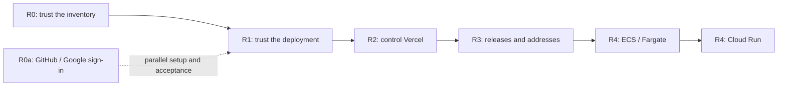
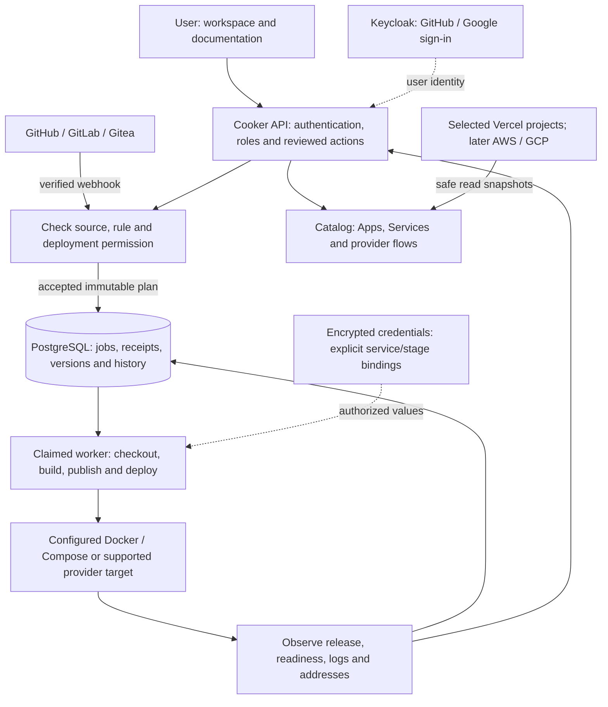

# Cooker — full feature roadmap

> Latest checked checkpoint: the 5 October 08:05 UTC local manual native journey passed. [Acceptance](/mnt/data/cooker-roadmap-20261002/environment-refusal-history-20261004/continuation-20261004/NATIVE-DAG-JOURNEY-ACCEPTANCE.md); [next automatic Git preparation](/mnt/data/cooker-roadmap-20261002/environment-refusal-history-20261004/continuation-20261004/native-gitea-automation-preparation-v1/CONTRACT.md). Full-roadmap completion remains open.


**Updated:** 5 October 2026, Asia/Bangkok; latest official App/runtime/restart verification recorded 5 October UTC. Earlier checks retain their dated scope.  
**For:** self-hosted users and small teams.  
**Product direction:** reliable Git-to-deploy, with Vercel as the first hosting integration.

Cooker should make three things clear: **what is deployed, where it runs, and how it got there.** The next releases turn the accepted workspace into a dependable deployment tool. Keep the Ready Block icon, brackets, Open Workbench illustrations, charcoal/ember and Paper themes, and the accepted landing, login, documentation and workspace layouts.

This guide explains the full scope and delivery order. The [technical plan](2026-10-02-consolidated-feature-roadmap.md) retains the detailed contracts and acceptance criteria. The [requirement ledger](/mnt/data/cooker-roadmap-20261002/roadmap-audit/requirements.json) tracks **45 work packages, 20 delivery/acceptance gates and 12 shared rules**. A package is complete only after its full gate passes; implemented code and a local test are separate states.

## 1. Starting point

The primary checkout is clean `develop` at `949d4a9`, checked on 3 October without a remote fetch. Pending implementation remains in the isolated `Cooker-backend` candidate. The running localhost application and the latest candidate have different build inputs.

| Feature | What exists | What still needs to be finished |
| --- | --- | --- |
| Vercel connection and sync | Encrypted token connection, explicit project selection, polling, history, freshness and coverage | Owner workspace acceptance; easier connection; event refresh |
| Vercel in Apps, Services and Pipelines | Selected projects have catalog entries and read-only provider flows | Complete service classification where provider data permits it; actual navigation and role checks |
| Native DAGs | Editable pipelines and dependency explanations; locally tested exact-source build, image publication and Docker deployment | One coherent official-server journey, hosted Git acceptance and remaining recovery cases |
| GitHub/GitLab/Gitea automation | Source connections, typed branch/tag rules, delivery decisions and durable jobs | Token replacement passed scoped backend/PostgreSQL and an isolated official HTTP/real-login UI campaign; hosted GitHub/GitLab acceptance, automatic missed-event recovery and coherent rollout remain |
| Configuration and secrets | Readable config, masked editing and supported Compose/native/Dockerfile bindings passed scoped real API/UI checks. Offline rotation passed CLI, database restart, COMMIT-uncertainty and genuine accepted-plan resolution checks; eight named Dockerfile current/fallback worker cases passed separately | Coherent official-server/fallback acceptance, remaining fsync/crash and executable recovery, unsupported transports and owner rollout |
| Service logs | Durable deployment logs and concrete-container runtime streams | Docker snapshot API and workspace controls passed isolated Docker/official HTTP/browser checks; coherent owner rollout remains. Kubernetes/provider sessions remain later work |
| GitHub and Google login | Existing OIDC broker integration, buttons and setup instructions | Registered provider apps, configured broker and real sign-in/account/role tests |
| Vercel deploy controls | A dedicated landing publication exists | Update that same project; explicit adoption; native Vercel stage; supported logs, promotion, rollback and config writes |
| Domains and tunnels | Provider addresses and existing operator routing | Ownership/DNS/TLS lifecycle, operator subdomains and persistent tunnel management |
| AWS and GCP | Some configured deployment adapters | Selected resource catalogs, complete observations/logs/recovery and independent account acceptance |

The last read-only account audit on **2 October** matched **13 selected Vercel projects to 13 Apps and 13 provider flows** in the connected team. It does not prove coverage of every Vercel account/team, and newly discovered projects are not silently selected. The last owner localhost `/health/ready` observation was JSON `200` with database status `ok` on **3 October at 03:46 UTC / 10:46 ICT**. This planning refresh did not recheck the owner installation; health does not validate every feature.

Recent isolated tests also proved real native and manual App execution using a compatible fallback worker, retained receipts and named revocation cases. Those dedicated source-built workers are distinct from official server dispatch and the owner installation. These results help close specific reliability criteria; they do not complete the roadmap.

Configuration acceptance now includes **41 real HTTP checks and five unmocked UI journeys** for Compose/native editing, followed by **40 HTTP checks and three role-based UI journeys** for Dockerfile bindings on a newer build. The latest Dockerfile frontend also passed 13 focused browser fixture cases, scoped lint and build checks. Earlier 375-unit, 23-focused-case and 32-regression results belong to the preceding frontend revision; they are retained separately.

Offline rotation passed private-input CLI, actual database restart, two named uncertain-COMMIT cases, and resolution of genuinely accepted deployment plans before/after rewrap and exact restore. The accepted jobs remained unclaimed: that campaign proves preserved authority and resolution, not worker execution. The backend baseline passed its full default race suite, with 21 optional cases skipped; the final App-version repair passed affected handler checks and the real API/UI journey. See the [current verification handoff](/mnt/data/cooker-feature-plan-20261003/configuration-runtime-refresh/README.md) for exact builds and limits. All **45 packages and 20 gates remain unaccepted as complete**; the missing runtime, recovery and release gates remain visible.

## 2. Delivery order

| Order | Release | User outcome | Why it comes here | Completion gate |
| --- | --- | --- | --- | --- |
| First | **R0 — trustworthy workspace** | See selected Vercel apps, components, production destinations and history | Every later action needs reliable resource identity and ownership | Correct selected inventory, honest service/status data, actual signed-in navigation and rollback |
| In parallel | **R0a — GitHub and Google sign-in** | Use either requested login method with explicit roles | Provider registration can progress alongside backend engineering | Real provider round trips, roles, recovery and working local administrator access |
| Next | **R1 — dependable Git-to-deploy** | Deploy an exact branch/tag through a real DAG, with scoped secrets and useful logs | Safe source, configuration and recovery are shared by every hosting adapter | Hosted source → accepted plan → real artifact → runtime → logs, including failure/restart cases |
| Then | **R2 — controlled Vercel operations** | Connect more easily and manage explicitly adopted projects | Builds on the existing integration and accepted execution contracts | Scoped real operations, exact project/release links and uncertain-write reconciliation |
| Then | **R3 — lifecycle and addresses** | Promote, roll back, attach a domain or use a managed tunnel | Requires known release/service identity and tested recovery | Supported release actions plus DNS/TLS/routing/tunnel lifecycle checks |
| Last in this program | **R4 — AWS, then GCP** | Use the same workspace for selected ECS/Fargate and Cloud Run services | Reuses the catalog, operation, secrets, logs and recovery contracts | Independent end-to-end acceptance for each provider |

Keep these as small releases with their own gates. Finish a working slice before introducing another execution adapter. Dates depend on verified engineering progress and provider setup; this plan does not substitute calendar promises for acceptance.



## 3. Architecture behind the roadmap

Keep the existing React workspace, Go API and PostgreSQL state/queue. The worker can run within the Go process; this plan does not require a microservice rewrite. PostgreSQL holds Cooker's durable jobs. Redis in the n8n example belongs to n8n.



Three connections remain independent: signing in establishes a Cooker user; a Git connection authorizes repository access; a hosting connection authorizes selected provider resources. GitHub sign-in alone does not grant private repository or Vercel deployment access.

Catalog records are presentation records. A synced Vercel flow explains a provider deployment; it does not recover an executable DAG. An imported project gains Cooker deployment actions only after a separate, reviewed adoption binding establishes its source, environment, permissions and deployment owner.

## 4. R0 — finish trustworthy Apps, Services and Pipelines

| Package | Deliverable | Acceptance |
| --- | --- | --- |
| CAT-01 | Explain verified components, configured components and unavailable service details | Never invent a database, queue, function or complete component inventory from a framework name or omitted response field |
| CAT-02 | Resolve aliases for the exact current production deployment | Production aliases match the provider; unique deployment URLs remain separate |
| CAT-03 | Reconcile selected projects into one catalog app and one provider flow each | Renames, token replacement and overlapping connections do not duplicate records; history links keep exact IDs |
| CAT-04 | Validate the actual workspace journey | Apps → Services → flow → release → provider dashboard works with roles, keyboard access, narrow screens and both themes |
| CAT-05 | Show sync coverage and limits | Connected account/team, selected/discovered counts, last success, pagination and stale/partial warnings are visible |

Use stable account/team/project IDs rather than names. Vercel views default to current production; latest preview and latest activity stay distinct. `READY` reports provider readiness; application health stays unchecked until a real probe establishes it. Filters apply before pagination, and partial sources cannot look complete.

Vercel Services can build multiple components within one shared deployment. Cooker must preserve that relationship and show only available, justified component information. [Vercel Services](https://vercel.com/docs/services)

**Release gate:** compare selected inventory read-only, verify the existing landing receipt, complete the owner journey, preserve native permissions and rehearse local application rollback. Do not create another deployment merely to demonstrate sync.

## 5. R0a — GitHub and Google authentication

| Package | Deliverable | Acceptance |
| --- | --- | --- |
| AUTH-01 | Register GitHub first, then Google, using the existing setup guide | Correct provider applications, scopes and exact broker redirects |
| AUTH-02 | Configure the existing operator-managed Keycloak broker | Issuer/audience, PKCE, callback/logout routes, allowed providers and role mapping agree between browser and API |
| AUTH-03 | Verify accounts and recovery | Real provider login, cancel/retry, expiry, deep-link return, logout, configured MFA and viewer/operator/admin checks |
| AUTH-04 | Document activation and fallback | Advertise only working methods; retain tested local administrator access |

Provider callbacks terminate at the broker; Cooker receives its existing OIDC callback. Provider secrets remain in the broker. Matching email addresses alone must not merge local accounts or grant roles. Follow the [Cooker setup guide](../user-guide/operations/social-sign-in.md); Google's registered redirect requirements also apply to the provider client. [Google OAuth web-server documentation](https://developers.google.com/identity/protocols/oauth2/web-server)

**Release gate:** both real login methods return to the intended Cooker page, permissions work and local sign-in plus the existing Vercel connection remain usable.

## 6. R1 — reliable automation, configuration and logs

### Git events and executable DAGs

| Package | Deliverable | Acceptance |
| --- | --- | --- |
| GIT-01 | Hosted GitHub acceptance with one scoped private repository | Authenticated delivery → exact branch/tag → accepted plan → real build/digest → Docker readiness and logs |
| GIT-02 | Real GitLab acceptance and Gitea regression | Private/nested repositories, typed refs, annotated tags, revocation and missed deliveries work per provider |
| GIT-03 | Connect authored native DAGs to Git rules | Pin repository, branch/tag namespace, commit, pipeline version, target, actor and review policy before admission |
| GIT-04 | Complete delivery decisions in the workspace | Show accepted, ignored, duplicate, stale, rejected, review-required and failed events, with reasons and intent/job/run links |
| GIT-05 | Secure source credential replacement and missed-event recovery | Replacement is checked; unchanged webhook keys are retained; old authority is invalidated; recovery cannot duplicate jobs or deploy stale refs |

**Current GIT-05 slice:** token replacement now has an admin/MFA API and masked workspace editor. Read-only metadata checks use the proposed token for the exact allowed repository paths before a conditional write. Known input/access refusals and stale-version conflicts preserve the saved connection; success retains the webhook key/configuration and advances authority version. An uncertain reply may follow a committed write and requires validated explicit reload. Late responses cannot clear newer drafts. Four affected Go packages passed 1,364 race entries; actual PostgreSQL persistence/concurrent writes, 375 frontend units and 16 browser fixture cases also passed. That earlier retained old872 executable has now passed an isolated official HTTP/real-login UI campaign: 50 scripted HTTP checks, 12 browser journeys, 28 SQL assert-connections checks, configured MFA denial and final audit scanning. Current877 subsequently passed the named official metadata API/UI journey on the retained319/80 frontend. Deployment-worker integration, hosted replacement/revocation and bounded automatic missed-event recovery remain separate gates. Cooker does not revoke the old token at the provider. See the [replacement contract](../backend/source-token-replacement.md) and [local verification handoff](/mnt/data/cooker-roadmap-20261002/source-credential-replacement-20261003/README.md).

**New scoped recovery verification:** manual App checks now reject stale rule/actor/version/ref/plan authority before private source access and recheck authority before inbox admission. Final frozen backend875 passed **1,366 affected race entries**, **four actual PostgreSQL entries**, both scoped vets and official static compilation. Real shared-inbox/App-producer tests prove deduplication, matching-rule fan-out and obsolete branch/tag decisions; their jobs remain pending and unclaimed. Source/inspection are fixtures, and a fresh SQL pool is not a process restart. The compiled binary has not been started. Automatic sweeps, hosted/combined API/UI, decision feedback and full GIT-05 acceptance remain open. See the [recovery contract](../backend/missed-ref-recovery.md) and [exact handoff](/mnt/data/cooker-roadmap-20261002/missed-ref-recovery-20261003/README.md).

**Missed-event recovery contract:** a manual check selects one full branch or tag ref using a current reviewed rule. Before private source reads, confirm the enabled saved rule, its version, machine actor, App/pipeline and configuration versions, allowed repository and matching ref. Verify exact repository/ref/commit identity and the reviewed deployment envelope; recheck current authority before inbox admission. Record recovery provenance and decision/intent links. The shared inbox evaluates all matching rules for that source and ref, so the interface must explain that an automatic matching rule can queue work after dispatch checks. Repeated recovery and a later webhook must reuse the logical intent and job. A moved branch becomes superseded; a changed tag requires review. Automatic recovery sweeps still need finite request/page/time budgets, cancellation, rate-limit handling and account-scoped acceptance. A final metadata check alone is not an atomic admission fence; queue/worker checks remain required.

The rule editor lets a user choose the provider/repository, **branch or tag**, matching policy, environment, native pipeline and automatic versus review-required deployment. A branch named `v1` and a tag named `v1` remain different. Accepted work keeps the original commit even if the branch moves later. Pipeline or credential edits do not silently rewrite queued authority.

Use the same admission contract for later Git providers, such as Bitbucket, but add each adapter only with its own authentication, event/ref, redelivery, rate-limit and hosted acceptance checks. An extensible interface does not establish support for an untested provider.

Webhook admission validates provider-specific authentication, event type and repository identity, records a durable decision, and queues work. Builds do not block the webhook response. GitHub recommends acknowledgement within ten seconds and uses the same delivery ID for redelivery, so deduplication must preserve that identity. [GitHub webhook guidance](https://docs.github.com/en/webhooks/using-webhooks/best-practices-for-using-webhooks) Provider details remain adapter-specific. [GitLab webhooks](https://docs.gitlab.com/user/project/integrations/webhooks/), [Gitea webhooks](https://docs.gitea.com/usage/repository/webhooks/)

Native DAGs show actual stages, forks, joins, failure paths and approvals. Every arrow explains its real condition; a text step list carries the same meaning. Imported Vercel flows remain labelled **Vercel-managed · Read-only** until separately adopted.

### Configuration, credentials and registry access

| Package | Deliverable | Acceptance |
| --- | --- | --- |
| SEC-01 | Finish readable-config versus protected-secret editing and service bindings | Database names and normal settings remain readable; passwords/tokens are protected; services receive only selected bindings |
| SEC-02 | Pin immutable external-secret versions | An accepted run gets its recorded version or refuses execution; unverified historical values cannot authorize replay |
| SEC-03 | Add encryption-key rotation tooling and recovery | Inventory all encrypted records, version ciphertext keys, retain backup/original-key recovery and test interrupted rotation/restore |
| SEC-04 | Scope registry credentials to each App and native stage | Build/push/pull use explicitly authorized, version-pinned credentials; unrelated global/host credentials cannot become fallback authority |
| SEC-05 | Redact every output boundary | Synthetic canaries do not enter durable logs, streams, errors, notifications, downloads or fixtures; split streaming chunks are covered |

Review deployment source/artifact, target, configuration and secret-version identities together. Runtime values are not arbitrary build arguments. Replacing a credential or secret value changes its logical generation and access authority. Rewrapping existing ciphertext under a different storage key preserves logical versions, accepted bindings and the source/configuration already recorded for a run. An online multi-key transition needs its own acceptance.

**Current SEC-01 slice:** ordinary settings are readable, protected drafts are masked and write-only, conflicts require explicit refresh/rebase, and delayed replies cannot clear newer drafts or act in a different session/route. Metadata reads return key names and capability information, without revealing values. Conditional database edits passed actual PostgreSQL concurrency and persistence checks; scoped real API/UI journeys passed for Compose/native editing and Dockerfile configuration. Compose binds keys per service. Dockerfile Apps bind runtime keys under the single `deploy` component, with an explicit empty default for new Apps and labelled legacy behavior for existing omitted scope. Test/Custom and Docker deployment stages retain their supported per-step contracts. Buildpack and other unsupported transports remain explicit capabilities. External stores without conditional-edit support do not fall back to an unversioned write. See the [binding contract](../backend/dockerfile-environment-bindings.md).

Eight subsequent named local Dockerfile cases passed: current and limited compatible source-built workers each deployed selected and empty bindings, and each refused changed environment generations before worker source/value/runtime effects. Selected cases also proved storage-key rotation followed by actual fresh-worker execution. These use exact older frozen producer/worker inputs, not the newest combined candidate or official server rollout. Those original frozen refusals lacked deployment-history rows. The newer confirmed-generation history repair passed 1,610 default race entries (eight optional database skips) and 56 actual PostgreSQL entries; Two new current selected/empty generation cases subsequently passed through genuine PostgreSQL App admission and fresh OS workers, each with one rejected history row, retained receipts, zero worker execution/private reads and preserved completed lifecycle projection. Coherent official-server/fallback/owner release acceptance remains separate. See the [history contract](../backend/preflight-deployment-history.md) and [repair handoff](/mnt/data/cooker-roadmap-20261002/environment-refusal-history-20261004/README.md). Full executable fallback/startup, coherent release and the owner journey remain before package acceptance. See the [runtime handoff](/mnt/data/cooker-roadmap-20261002/dockerfile-environment-bindings/runtime-20261003/RUNTIME-HANDOFF-v5.md).

**Current SEC-03 slice:** the offline `inventory`, `rotate`, `status` and `restore` tool covers environment secrets, App webhook keys, Git source credentials, Vercel credentials and encrypted notification configuration. It authenticates key-version headers and backup contents, preserves logical versions, and refuses stale restore or active work. Actual PostgreSQL 16.15 checks passed rotation, exact original restore, per-family SQL-fault rollback, drift and unsafe-state refusals. Private-input cancellation, separate CLI processes, actual database restarts and two named uncertain-COMMIT cuts also passed. A further campaign preserved genuinely accepted Dockerfile/native jobs and registry authority through rewrap, restart and restore, checking their resolvers in fresh processes without claiming or executing the jobs. A full private filesystem produced a real ENOSPC probe and CLI backup refusal, with exact pre-rotation database state retained. Current and limited older-reader backport passed versioned/legacy ciphertext, malformed-format and fresh-process reader checks. Those scoped reader results do not establish server startup or worker execution. Remaining process-loss windows, file/directory fsync faults, tagged-compatible executable/runtime recovery and coherent owner rollout stay open. Automatic approval review rejected preparation of a tracing fault-injection campaign; no tracing runtime ran or bypass was attempted. Keys remain in private input; default writes stay legacy until explicitly configured. The owner key has not been rotated. See the [editing contract](../backend/environment-secret-editing.md) and [rotation runbook](../backend/offline-key-rotation.md).

### Service logs and reliable execution

| Package | Deliverable | Acceptance |
| --- | --- | --- |
| LOG-01 | Docker replica selector, time range, bounded search, paging/reconnect and redacted download | Concrete container/run identity, role restrictions, limits, expiry and redaction are checked through the real API and UI |
| LOG-02 | Immutable Kubernetes log sessions | Capture controller generation, pod UID, container and restart identity; a replacement pod cannot silently become the same session |
| REL-01 | Complete crash/cancellation cases | Worker loss before/during/after external mutation and result persistence cannot blindly redeploy; stale claims cannot write results |
| REL-02 | Complete scheduler and notification recovery | Restart cannot double-fire an occurrence; notification attempts/retries/status are visible and separate from deployment success |
| REL-03 | Accept upgrade/restore and measure capacity | Retained encrypted records, accepted jobs, history and cursors survive the supported path; measured latency and queue delay support capacity claims |

The candidate now offers these Docker controls in Apps and Services. Affected Go checks, frontend tests and isolated official HTTP/browser acceptance passed. The real log campaign uses manually launched replicas and explicitly seeded deployment history; it proves log inspection, not a new Cooker deployment. Snapshots remain process-local with ten-minute logical expiry, not a durable archive. Existing live streams remain separate. Coherent owner rollout and the wider R1 journey are still open.

If a worker cannot tell whether an external operation happened, retain **Needs attention** and inspect the exact resource before resolving it. Queue acknowledgement, successful build, provider readiness and application health are separate outcomes. A retry must not create a second deployment to hide an uncertain first attempt.

**R1 release gate:** one coherent official-server/UI journey from hosted exact source to real artifact, runtime and service logs; Gitea regression; supported GitLab acceptance; secrets/rotation/output checks; remaining crash/cancel/upgrade/restore checks; operator runbooks. Isolated helper tests remain scoped evidence.

## 7. R2 — Vercel as the first controlled hosting integration

| Package | Deliverable | Acceptance |
| --- | --- | --- |
| VRC-01 | Easier registered integration/OAuth connection | Exact account/team, explicit selection, encrypted credentials, disconnect/revocation and separately permitted writes |
| VRC-02 | Optional event-driven refresh alongside polling | Authenticated/deduplicated events schedule safe reads; polling repairs missed events; discovery stays opt-in |
| VRC-03 | Update the existing Cooker landing project | Reviewed bundle targets its retained project; one operation records the deployment and production result without a duplicate project |
| VRC-04 | Explicitly adopt a project for Cooker deployment | Reviewed binding records source, environment, actions, provider ID and deployment owner; imported records stay read-only by default |
| VRC-05 | Add a bounded Vercel stage to native DAGs | Immutable source/artifact plus binding; native run links to exact provider deployment and catalog history |
| VRC-06 | Supported provider inspection and logs | Tested permissions/retention, concrete release references, redaction and explicit unavailable states |
| VRC-07 | Promote or roll back supported Vercel releases | Pin selected release and current production preconditions; retain operation/alias history and reconcile external or uncertain changes |
| VRC-08 | Separately authorized provider environment editing | Scope names/targets by project/environment and supported service; mask protected values and review writes/rotation |

Sequence the write work as **binding and operation contracts → existing landing update → general Vercel stage → supported logs/lifecycle/configuration controls**. OAuth and event refresh can proceed alongside it; the existing encrypted token connection remains an operator option.

Do not let both Vercel Git auto-deploy and Cooker independently submit the same intended release without an explicit ownership policy. Safe provider snapshots continue to exclude environment values, credentials and raw logs even when a separate environment-editing action exists.

**Release gate:** scoped connection changes, one permitted deploy/update, retained external ID, actual inspect/failure/reconciliation, exact App/flow/run/release links and supported action tests. An unknown POST outcome is inspected, not blindly repeated.

## 8. R3 — release lifecycle, domains and tunnels

| Package | Deliverable | Acceptance |
| --- | --- | --- |
| LIFE-01 | Dispatch approved promotion | Exact source/target environments, artifact/config versions, approver and actual rollout result |
| LIFE-02 | Return to a known prior application release | Immutable prior artifact, target/config review, readiness and reconciliation; database compatibility is assessed separately |
| LIFE-03 | Gradual traffic/canary where supported | Desired and observed traffic, real adapter support and uncertainty/restart handling |
| DOM-01 | Custom domain ownership, route and TLS lifecycle | Exact service/environment target, ownership verification, propagation, collisions, certificate issue/renewal and restart/failure tests |
| DOM-02 | Operator-provided subdomains | Operator controls the base zone/routing; users of that installation need not buy individual domains |
| TUN-01 | Persistent Cloudflare Tunnel adapter | Encrypted credentials, owned connector/routes, reconnect/restart/revocation and tested access policy |
| TUN-02 | Optional temporary development address | Clearly temporary scope, automatic expiry/cleanup; ngrok remains a later adapter option |

A user can choose a **provider address**, an **operator-provided subdomain**, a **verified custom domain**, or a **configured tunnel**. Cooker does not automatically supply a permanent public domain for every self-hosted installation. Stable addresses depend on the operator/provider configuration. Cloudflare Tunnel uses outbound connections; Quick Tunnels provide temporary testing addresses. [Cloudflare Tunnel](https://developers.cloudflare.com/tunnel/), [Quick Tunnels](https://developers.cloudflare.com/tunnel/get-started/quick-tunnels/)

Keep DNS ownership, routing, TLS and reachability as separate observations. Expose only the reviewed web/API service; database, Redis, Docker and administrative endpoints remain governed by explicit target/access policy. `draveniq.dev` apex and `www` are not assigned by assumption.

**Release gate:** supported promotion/rollback plus real ownership, DNS/TLS renewal, exact service routing and persistent tunnel recovery on scoped test resources. Application rollback does not automatically reverse database data or migrations.

## 9. R4 — bounded AWS and GCP support

| Package | Deliverable | Acceptance |
| --- | --- | --- |
| AWS-01 | Selected ECS/Fargate catalog | Stable account/region/resource identity, freshness and explicit selection |
| AWS-02 | Complete ECR/ECS deployment and observation | Immutable image, task/service revision, permissions, readiness, configured endpoint/access and CloudWatch logs |
| AWS-03 | Durable failure/cancel/rollback reconciliation | External operation identity and supported prior-good revision behavior survive restart |
| GCP-01 | Selected Cloud Run catalog | Stable project/region/service/revision identity, freshness and explicit selection |
| GCP-02 | Complete Artifact Registry/Cloud Run operation and observation | Revision readiness, IAM/ingress/access, available address, Cloud Logging and retained operation state |
| GCP-03 | Revision traffic promotion/rollback | Desired versus observed traffic and transition/recovery behavior |

Start with ECS/Fargate, then Cloud Run. AWS container logs require the appropriate task log configuration and permissions. Cloud Run traffic changes have transition behavior that must be observed rather than reported as instantaneous. [ECS logging](https://docs.aws.amazon.com/AmazonECS/latest/developerguide/using_awslogs.html), [Cloud Run traffic migration](https://docs.cloud.google.com/run/docs/rollouts-rollbacks-traffic-migration)

**Gate per provider:** selected inventory → scoped disposable deploy/update → revision/readiness → endpoint/access → supported logs → failure diagnosis → supported recovery/rollback → owned cleanup. Set account/project, region, cost ceiling and resource ownership before live writes. RDS/Cloud SQL, queues and general infrastructure provisioning remain later proposals.

## 10. Real examples used for acceptance

### Cooker landing on Vercel

Find the existing landing in **Apps → Website component → Vercel flow → exact release**. Attribute its source to the uploaded Cooker landing bundle and recorded artifact, without manufacturing Git metadata. Compare confirmed production aliases separately from deployment URLs. Then, in R2, review the current branded public bundle and update that same retained project. Check actual served assets, icon, operation history and production destination.

### n8n queue mode on Docker

Use four services: **PostgreSQL, Redis, n8n main/web and n8n worker**. Main and workers use the database and Redis and need the matching n8n encryption key. [n8n queue-mode documentation](https://docs.n8n.io/hosting/scaling/queue-mode)

```text
Deployment explanation
  PostgreSQL ready ─┬─> n8n main/web
                   └─> n8n worker
  Redis ready ─────┬─> n8n main/web
                   └─> n8n worker

Runtime explanation
  n8n main/web ──> Redis queue <── n8n worker
  n8n main/web ──> PostgreSQL <── n8n worker
```

Readiness is established by actual Compose/adapter checks; generic native DAG edges retain their supported success/failure/always conditions. Do not invent a worker → web startup dependency. Review pinned source/images, bind config/secrets per service, deploy, inspect exact service identities/logs, pause only the disposable worker, observe a waiting job, resume it and verify completed execution in the database and worker log. Extend the fixture to supported update/recovery/rollback with explicit database compatibility.

## 11. The next implementation batch

This is the next bounded batch, not permission to mark all later packages complete:

1. **Close the actual R0 workspace journey.** Verify selected coverage and follow the existing landing through App, Service, read-only flow, release and provider dashboard. Fix only discovered integration defects.
2. **Carry the verified LOG-01 candidate into the coherent rollout.** API, workspace controls, source review, both-theme fixtures and actual owned Docker/official HTTP/browser checks have passed. Reuse that evidence; freeze the release build, preserve rollback inputs and complete the owner journey. Kubernetes/provider sessions remain separate.
3. **Close the remaining configuration and offline-rotation boundaries.** Compose/native configuration passed 41 actual HTTP checks and five unmocked UI journeys; the separate Dockerfile campaign passed 40 HTTP checks and three role journeys on its newer build. Reuse those results and the completed private-input CLI, process/database restart, named COMMIT-cut, genuine admitted-plan resolution and eight named source-built Dockerfile runtime/fallback tests. Complete coherent official-server/fallback acceptance, retain the two current and two same-fallback generation-history worker cases; verify official fallback startup and the coherent deployment/log journey, and finish the remaining crash/filesystem-sync faults. A full private filesystem backup refusal already preserved exact pre-rotation state; file/directory fsync faults remain. Test tagged-data recovery with an explicitly compatible executable or the exact original backup/key. Keep unsupported binding transports visible. GIT-05 token replacement now has scoped local backend, PostgreSQL and named old872/current877 official metadata HTTP/UI passes; finish the official deployment-worker/log journey, hosted replacement and missed-event gates separately.
4. **Close the remaining source/registry/recovery gaps in one official-server candidate.** Reuse the completed named proofs; add only genuinely missing transport, crash/cancel, supported upgrade/restore and coherent runtime checks.
5. **Complete hosted GitHub, then real GitLab acceptance.** Use an explicitly scoped repository/callback campaign and retain Gitea regression.
6. **Prepare a coherent R0/R1 release candidate.** Freeze exact source/build inputs, finish task/developer/operator docs, retain previous builds and keys/database, and rehearse local activation/rollback under the deployment scope.
7. **Begin the R2 existing-project binding/update slice.** Give the existing Cooker landing the first supported update path before generalizing Vercel stage execution.

In parallel, prepare GitHub/Google registrations and the broker setup. External setup does not block reversible local API, UI or tool work. Finished named tests are not rerun without changed inputs or a specific unresolved gate. Conversely, missing features are not treated as completed merely because neighboring tests pass.

## 12. Roles, contracts and release checks

Catalog reads and inspection use the current authenticated roles. Operator/admin action checks remain server-enforced. Secret, connection and adoption management follow the existing administrative policy; a hidden button is not authorization. Log access follows the existing runtime-log role policy until separately reviewed.

Reuse these boundaries:

| Boundary | Responsibility |
| --- | --- |
| Catalog | Safe selected-resource reads, stable identity, filtering/paging, ownership, freshness and capabilities |
| Source admission | Provider authentication, typed refs, policy/review, deduplication and exact commit |
| Accepted deployment | Versioned source/artifact/config/credentials/target/actor and a durable receipt |
| Queue and worker | Claims/heartbeats/fences, serialized execution, retained result and safe recovery |
| Provider operations | Preflight, durable intent, submit/acknowledged IDs, observation and reconciliation |
| Logs and addresses | Concrete deployment identity, permission, redaction, limits, retention/access and observed status |

The five `/api/v1/catalog` endpoints stay authenticated reads. Imported IDs cannot start native jobs. New provider action routes require their own reviewed binding/intent, role, supported capability, pinned versions and operation status. Confirm existing record overlap before adding additive, upgrade-tested tables.

Each release needs affected automated checks, real PostgreSQL persistence/recovery where relevant, the actual authenticated workspace journey, and scoped provider acceptance. Browser fixtures are separate evidence from a real owner session. Record **implemented → locally verified → live accepted → released** separately.

Retain the 12 rules covering identity, imported read-only behavior, safe snapshots, current production, honest service/health status, pagination, bounded sync, exact Git refs, scoped secrets, uncertain operations, reviewed addresses and accepted design. The technical plan and ledger retain their full wording.

Document user tasks in the existing **Documentation** page, developer API/model details in its technical reference, and setup/rotation/recovery/rollback in operator guides. Record exact source/build manifests and outcomes. Integrate accepted slices through the verified `develop` workflow; planning/local tests do not imply a merge, public publication or provider mutation.

## 13. External inputs by phase

| Phase | Input needed for its real acceptance |
| --- | --- |
| R0 | Existing connection and owner sign-in/navigation; account/team coverage is explicitly scoped |
| R0a | Registered GitHub/Google clients, broker origin, role/MFA policy; secrets entered securely in the broker |
| R1 | Permitted GitHub/GitLab repositories, reachable owned HTTPS callback; scoped registry/cluster/provider credentials only where required |
| R2 | Registered integration if OAuth is used; exact project adoption/write scope and permitted test resources |
| R3 | Operator domain/zone or tunnel account, exact target/access policy and scoped routing ownership |
| R4 | Chosen account/project and region, least required permissions, cost ceiling and cleanup ownership |

Additional providers, broad infrastructure provisioning, durable provider-log archives, automatic database rollback and hosted multi-tenant Cooker remain later proposals. The program is complete when all 45 packages and their 20 gates are accepted, documented and coherently integrated while preserving the 12 rules.

## Evidence pointers

- [Full technical plan](2026-10-02-consolidated-feature-roadmap.md) and [requirement ledger](/mnt/data/cooker-roadmap-20261002/roadmap-audit/requirements.json).
- [Existing execution record](/mnt/data/cooker-roadmap-20261002/README.md) and [selected-team audit/status record](../backend/current-status-2026-10-02.md).
- [Native compatible-worker execution](/mnt/data/cooker-roadmap-20261002/registry-authority/compatible-fallback-native/HANDOFF.md) and [manual App execution](/mnt/data/cooker-roadmap-20261002/registry-authority/compatible-fallback-app/HANDOFF.md): named local scopes; official-server/hosted/owner gates remain.
- [Docker snapshot verification](/mnt/data/cooker-roadmap-20261002/runtime-log-sessions/verification.json), [independent actual-API evidence check](/mnt/data/cooker-roadmap-20261002/runtime-log-sessions/root-actual-http-verification.json) and [operator/API guide](../backend/runtime-log-snapshots.md): native Docker logs in a candidate, with seeded fixture history; coherent owner activation and full R1 acceptance remain.
- [Actual configuration API/UI handoff](/mnt/data/cooker-roadmap-20261002/sec01-frontend/actual-api-ui/HANDOFF.md): 41 HTTP checks and five synthetic-role UI journeys on its exact Compose/native build; no owner rollout or new Dockerfile runtime claim.
- [Dockerfile backend binding contract](../backend/dockerfile-environment-bindings.md), [frontend handoff](/mnt/data/cooker-roadmap-20261002/dockerfile-environment-bindings/frontend-v3/HANDOFF.md) and [real API/UI handoff](/mnt/data/cooker-roadmap-20261002/dockerfile-environment-bindings/actual-http-ui/phase-b-v2/HANDOFF.md): explicit `deploy` keys, empty defaults, labelled legacy behavior, 40 HTTP checks and three role journeys; worker/runtime and fallback acceptance remain separate.
- [Offline SQL rotation verification](/mnt/data/cooker-roadmap-20261002/key-rotation/verification.json) and [actual CLI/restart/COMMIT verification](/mnt/data/cooker-roadmap-20261002/key-rotation/cli-restart/verification.json): five-family storage rewrap, exact restore, 14 CLI processes with two database restarts and six CLI processes across two named wire cuts.
- [Accepted-plan rotation handoff](/mnt/data/cooker-feature-plan-20261003/configuration-runtime-refresh/README.md): seven CLI processes, six fresh accepted-plan resolver processes, one database restart, exact state/receipt preservation and a real full-filesystem backup refusal. Jobs were not executed; remaining crash/fsync, executable recovery and owner gates stay open.

- [Source replacement verification](/mnt/data/cooker-roadmap-20261002/source-credential-replacement-20261003/README.md): exact 872-backend/319-frontend inputs and named local checks; full GIT-05 remains open.
- [Tagged-reader compatibility handoff](/mnt/data/cooker-roadmap-20261002/dockerfile-environment-bindings/runtime-20261003/COMPILE-READER-HANDOFF-v1.md): historical current and limited backport reader checks only; the later runtime campaign is separately recorded below.
- [Actual eight-case Dockerfile runtime handoff](/mnt/data/cooker-roadmap-20261002/dockerfile-environment-bindings/runtime-20261003/RUNTIME-HANDOFF-v5.md): four genuine current/fallback runtimes, two selected rotation-to-execution boundaries and four changed-generation refusals on older exact inputs. The newer history repair is separately recorded; new combined official-server/fallback/owner acceptance remains open.
- [Manual missed-ref recovery handoff](/mnt/data/cooker-roadmap-20261002/missed-ref-recovery-20261003/README.md): final875 guard/producer evidence, retained failures and independent audit; no worker or hosted/API/UI execution.
- [Confirmed-generation rejection history repair](/mnt/data/cooker-roadmap-20261002/environment-refusal-history-20261004/README.md): final877 logical source, unchanged-code reproduction, affected race/actual PostgreSQL, source review and two new genuine producer/fresh-worker refusal cases; coherent official/fallback/owner acceptance remains open.


The isolated old872 official-server/source-token campaign subsequently passed **50 scripted HTTP status checks, 12 real-login browser journeys and 28 SQL assert-connections checks**, with concurrent200/409 replies counted separately. The checks cover GitHub/GitLab/Gitea metadata replacement, masked drafts, validated reload after real conflicts/lost acknowledgement, SPA late replies, both mobile themes, sign-out cancellation/session refusal, roles, configured MFA denial and final audit scanning. Exact recorded resources, including stopped containers, were independently verified absent. See the [actual handoff](/mnt/data/cooker-roadmap-20261002/source-credential-replacement-20261003/actual-http-ui-preparation-20261004/revision-v3/ACTUAL-HANDOFF.md).

Both earlier failed fixture trials remain preserved: full-document navigation during the intended SPA test, then an unsupported extra browser cancellation-event requirement despite provider cancellation and unchanged SQL. The passing revision retained the actual provider, database and session checks. This is local old872/319 acceptance, not hosted Git access, successful OAuth/MFA, current877 worker execution, owner UAT or whole-release acceptance.

The current877 official executable subsequently passed the same named local metadata campaign: **50 scripted HTTP status checks, 12 real-login UI journeys and 28 SQL assert-connections checks**, with configured MFA denial, five persisted connections, 32 privately scanned audit rows and zero business rows. The exact319 frontend matches the candidate; the retained874 helper has320 matching named contracts. The byte-identical browser retains its historical old872 scope label; the reviewed manifest, mounted official executable and migration identity establish current877 runtime attribution. See the [current official metadata handoff](/mnt/data/cooker-roadmap-20261002/environment-refusal-history-20261004/continuation-20261004/coherent-source-http-ui-v1/ACTUAL-HANDOFF.md). This does not execute deployment work or prove hosted Git/OAuth, owner UAT or a whole release.

The reason-aware854 fallback also completed its scoped build checks. The interrupted first container was terminal137/OOMKilledfalse with causeunknown; recovered artifacts prove1,145 race pass entries/513 top-level/five packages/eight optional PostgreSQL skips and both vets exit0. A separate static-only continuation on unchanged source compiled/exported successfully; its executable remains unstarted and exact owned resources are absent. See the [fallback build handoff](/mnt/data/cooker-roadmap-20261002/environment-refusal-history-20261004/fallback-preparation-20261004/static-build-continuation-v2/STATIC-HANDOFF.md). Two new reason-aware854 fallback selected/empty refusal cases then passed genuine PostgreSQL admission and fresh OS workers, with one rejected history each, zero worker execution/private reads and preserved receipts/outcome. Both producer and worker are fallback854; this does not prove current-to-fallback admission or official fallback startup. See the [bounded fallback worker acceptance](/mnt/data/cooker-roadmap-20261002/environment-refusal-history-20261004/continuation-20261004/FALLBACK-WORKER-ACCEPTANCE.md). The complete official-server deployment/log journey and recovery/owner/release gates remain separate.


### 4 October continuation — recorded runtime controls and responsive correction

Dockerfile/single-image deployment views now use the recorded deploy stage ID for runtime status/logs; Compose uses its component name. The interface distinguishes current recorded service logs from the historical run outcome. Unsupported, build, approval and unrecorded stages cannot open that stream, and selection changes close it. A confirmed phone inspector overlap was corrected by stacking diagram, console and inspector on narrow screens. Cooker identity and desktop positioning remain unchanged.

The corrected320/80 frontend passed two390px dark/light cases, six relevant1440px regressions, TypeScript, scoped lint and build. Pointer, keyboard, exact service path and stream-close assertions stayed intact. Previous20 browser cases/64 units and earlier319 actual metadata acceptance retain their separate source scopes. These new cases use intercepted API/auth/WebSocket fixtures; they do not establish an official-server deployment, owner rollout or whole LOG-01/R1 completion. See [frontend runtime acceptance](/mnt/data/cooker-roadmap-20261002/environment-refusal-history-20261004/continuation-20261004/RUNTIME-UI-ACCEPTANCE.md).


### 5 October continuation — official App deployment, live logs and normal restart

The corrected878 official server and accepted320/80 frontend passed one actual isolated manual Dockerfile App journey: private local Gitea exact commit → registered worker → BuildKit OCI digest → authenticated registry → owned Docker readiness → matching App/history/service/runtime logs and log snapshot → ordinary idle server restart. Four real browser checks passed,24 finished/24 completed body tasks, two runtime frames and the expected marker; no API/auth/WebSocket mocks or auth injection. PostgreSQL before/after retained one job/attempt/history, the same container/build logs and seven durable state hashes. The old in-memory snapshot returned404; a new capture read the original workload marker. HTTP bodies were scanned before forwarding112+7responses with zero scan/unknown-transport/forward-before-scan violations. Root independently checked29 Docker identity/name/UUID absences plus browser/config removal.

The real request-context WebSocket defect was repaired with connection-owned cancellation and shutdown-aware hub registration. The regression failed on the old handler and passed after the repair;113 affected server race pass events and scoped vet passed. A128MiB linker-staging failure was retained, then a fresh512MiB compile-only run succeeded on unchanged source/compiler. Earlier request, password-parser, origin, response-observation and startup-audit failures remain preserved. V9 recorded actual pre-readiness ConnectionRefusedError separately; V8's unrecorded exception subtype remains unknown. See [scoped local acceptance](/mnt/data/cooker-roadmap-20261002/environment-refusal-history-20261004/continuation-20261004/OFFICIAL-APP-JOURNEY-ACCEPTANCE.md) and its exact source/build/runtime manifests.

This App-only positive journey does not complete an authored native DAG, hosted Git/webhook/OAuth/MFA, selected-secret redaction, fallback startup, cross-version/rollback/crash recovery, owner activation or release. All45 packages and20 gates remain not_proven; all12 invariant definitions remain unchanged. Native Run/stage readiness and application stdout need an immutable deployment-time container receipt; that next observation contract is proposed, not implemented or executed by this acceptance. Owner4644/env/key and hosted projects were untouched; the prior owner-browser denial was not bypassed. No merge, push, tag or public publication occurred.

The next local native observation slice is [accepted for implementation](/mnt/data/cooker-roadmap-20261002/environment-refusal-history-20261004/continuation-20261004/native-runtime-observation-contract-v1/ROOT-CONTRACT-REVIEW.json), with the [same-name receipt refinement](/mnt/data/cooker-roadmap-20261002/environment-refusal-history-20261004/continuation-20261004/native-runtime-observation-root-refinement-v1/ROOT-REVIEW-REFINEMENT.md). First implement optional server-owned Docker receipt capture and persistence; native routes, logs and UI follow separately. A started implementation task is not test/runtime acceptance.


### 5 October2026 — native Docker receipt first slice

The optional immutable container/image/run/stage receipt is implemented and locally accepted in the isolated candidate:531 affected top-level race tests/19new receipt tests, scoped vet/static main and integration-fixture compilation, then one real PostgreSQL JSONB/fresh-pool test. Seven separate liveSQL defaults skipped and are not counted as persistence proof. The failed unstarted DB fixture, exact cleanup and created-network correction are retained. No OSrestart, native status/log API, workspace control or authored DAG deployment is established. The next status-only service is under review, including configuration versus current health.

Evidence: [native receipt checks](/mnt/data/cooker-roadmap-20261002/environment-refusal-history-20261004/continuation-20261004/NATIVE-RECEIPT-CHECKS.md). All45package/20gate completion statuses and12invariant definitions are unchanged. No owner/provider, credential/key/domain, integration/release or publication changes.


### 5 October 2026 — native status service and authenticated HTTP locally accepted

The optional native Docker receipt now supports a read-only status service and `GET /api/v1/pipelines/:id/runs/:runId/stages/:stageId/runtime`, with existing authenticated read roles including viewers. Cooker resolves retained accepted run/stage/image identity and the exact receipt container ID; edited definitions do not replace that authority. Missing, legacy, imported, unsupported or unverifiable subjects stay unavailable. Recorded deployment success, current container state and Docker health are distinct; a configured check without a result remains unknown. No synthetic App or workload is created.

The frozen888 service source passed **428 top-level tests / 1,085 pass events / all17 new cases**. The frozen891 HTTP source passed **297 top-level tests / 467 pass events / all9 new cases once**. Affected race tests, scoped vet and static builds passed with zero failures/skips; both official main binaries remain unstarted. Real registered HTTP handlers, roles and task-owned CLI/record fixtures were exercised. These are scoped local checks, not actual authored native DAG, native logs, live workspace, owner or hosted-provider acceptance. Root independently checked six exact resource/UUID absences per campaign. [Dated acceptance and exact evidence](/mnt/data/cooker-roadmap-20261002/environment-refusal-history-20261004/continuation-20261004/NATIVE-STATUS-HTTP-ACCEPTANCE.md).

The next backend task is the five-path native/App shared-cache service logs implementation, while frontend status/log controls are being prepared. Native logs tests, live interface checks and the authored Git source → queued worker → checkout → image digest → Docker status/service logs journey remain open. Earlier first-slice/status-pending paragraphs are historical; this dated supplement updates those sub-slices only.

All **45 package / 20 gate completion fields remain `not_proven`**, with all **12 invariant definitions unchanged**. Owner4644/env/key, hosted projects and domains are untouched; the earlier owner-browser denial is not bypassed. The historical13-selected Vercel audit and owner readiness are not refreshed by these checks. No merge, push, release or public publication occurred.


## Current native runtime checkpoint — 5 October 2026, 08:05 UTC event

The official native Build → Push → Docker deploy journey is now accepted in an isolated local campaign, with runtime status, redacted snapshots/downloads/live logs, genuine administrator/operator/viewer checks and an ordinary same-database/key restart. Actual87320 exited0:66API assertions+2readiness checks,10realbrowser checks,4nativeframes,39/39 finished body tasks with no unread bodies. Six encrypted-row hashes stayed unchanged; one job/attempt/run/history remained. Exact resource cleanup is verified. Backend898/helper900-v5/frontend331/bundle81 are separately bound; earlier affected-Go and two-theme synthetic UI checks retain their own scopes.

[Read the acceptance and limits](/mnt/data/cooker-roadmap-20261002/environment-refusal-history-20261004/continuation-20261004/NATIVE-DAG-JOURNEY-ACCEPTANCE.md). Prior log-work preparation checkpoints are historical for this named slice. Three failed attempts remain failed and retained; the accepted observer normalizes empty actor groups and uses genuine protected deep-link sign-in so pending overview responses are not lost across test navigation. No product bytes or acceptance predicates were relaxed for those harness corrections.

**Next:** [real Gitea automatic native branch deployment and authenticated receiver dedupe](/mnt/data/cooker-roadmap-20261002/environment-refusal-history-20261004/continuation-20261004/native-gitea-automation-preparation-v1/CONTRACT.md). That packet is source-reviewed preparation, with no driver/helper or automatic execution yet. It builds on the now-accepted manual native chain. Review-required rules, tags/edits/revocation, hosted GitHub/GitLab, owner/Vercel/OAuth/MFA, process-loss/fallback/cross-version/restore and release gates stay separate. The full45package/20gate roadmap remains unproven; their definitions, completion fields and12invariants are unchanged.

Process-tracing preparation previously failed automatic approval review for possible cybersecurity risk. No tracing test ran, and that refusal is not bypassed by this ordinary-restart proof.
