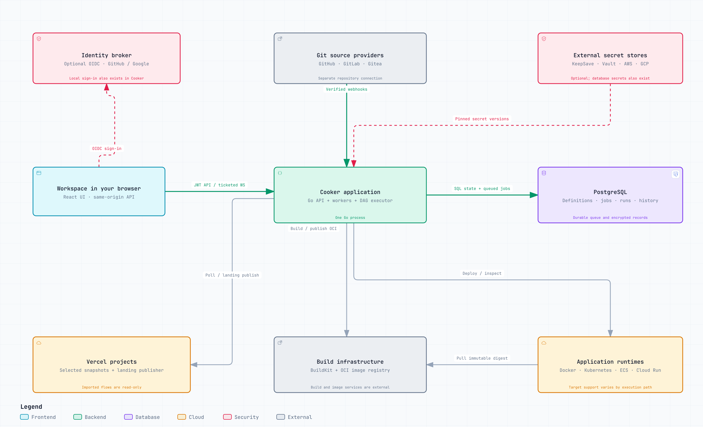
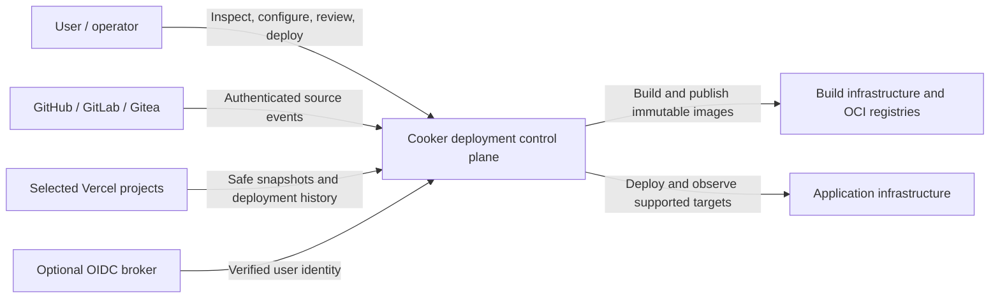
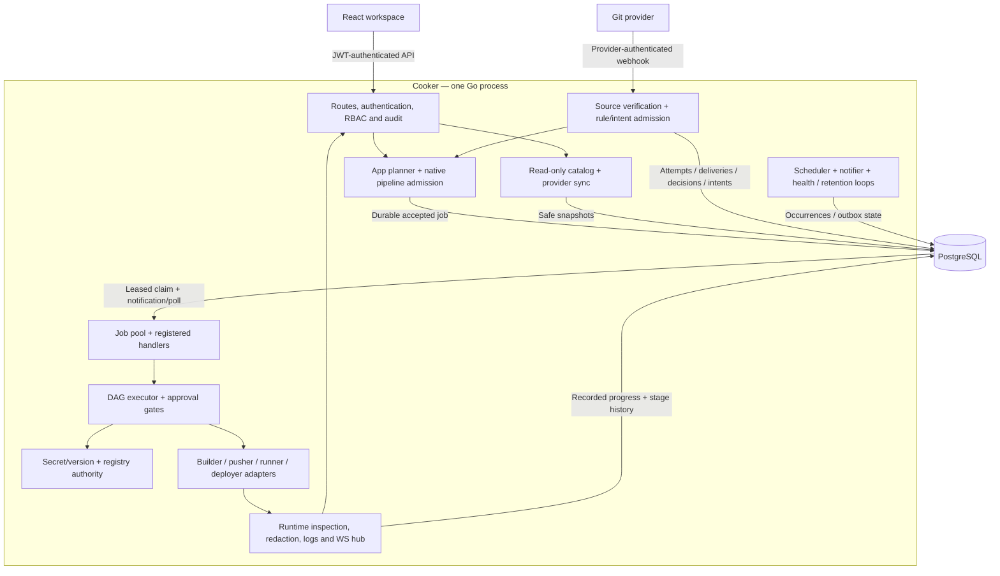
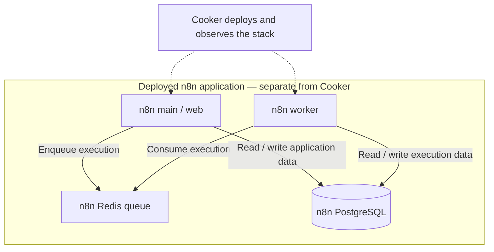

# Cooker — full system architecture

**Source review: 25 October 2026, Asia/Bangkok.** This describes the inspected backend candidate, based on `949d4a9` plus pending changes. It is not a claim about the currently running installation or a released build.

[Open the interactive system map](system-overview.html) · [Current remaining plan](../../plans/2026-10-25-remaining-delivery-plan.md) · [Working-tree source evidence](SOURCE-REVIEW.json)



Cooker is a **modular Go application with a React workspace and PostgreSQL-backed durable execution**. API handlers, source automation, workers, DAG execution, scheduler, provider polling and live-event handling are modules/background loops inside the same Go process. The architecture does not require independent microservices for each box.

**Later local source checkpoint, 25 October:** installation-access metadata now flows through Vercel snapshots into existing catalog/Cloud/Settings views. [M3-A landing adoption](../../plans/2026-10-25-vercel-ecosystem/M3-A-CHECKPOINT.md) adds a separate `vercel_landing_adoptions` authority table inside the same PostgreSQL boundary, safe project-assessment reads and authenticated/admin API configuration. It adds no provider-write or update-job path. The system map and its original source receipt remain the earlier baseline; new source inputs and unexecuted acceptance are recorded in the checkpoint. Product tracking is now in the [Cooker ClickUp board](https://app.clickup.com/90181387221/v/l/li/1100540000004771).

## 1. C4 context: what is inside Cooker?



Cooker owns the deployment definitions, accepted plans, jobs, run history, permissions and observations. Git hosting, image registries, deployment platforms, identity providers and deployed applications remain external systems.

## 2. C4 containers: what actually runs?

| Runtime boundary | Responsibility | Status / important limit |
| --- | --- | --- |
| Browser | React/TypeScript workspace, graph/text views, API calls and live views | The user interface runs here. Its assets normally come from the Go server. |
| Cooker Go process | Gin API, local/OIDC authentication, roles, services, worker pool, executor, scheduler, Vercel sync, notifications and WS hub | One application process containing many logical components; workers are goroutines in this startup path. |
| PostgreSQL | Durable definitions, jobs/claims, accepted source and configuration references, decisions, runs, approvals, publication state and stage-log history | Production persistence and durable execution queue. Separate SQL pools can use the same configured database. |
| Optional Redis | Shared WebSocket tickets, rate limiting and pub/sub fan-out | Not the durable deployment queue; not required for PostgreSQL job admission. |
| Build infrastructure | Selected builder/runner, BuildKit daemon, OCI registries and image transport | Separate execution boundary. App production source builds use the supported BuildKit/Crane path; configured production BuildKit TCP requires mutual TLS. |
| Application infrastructure | Docker/Compose, Kubernetes and configured cloud destinations | External to Cooker. Supported operations vary by App versus native pipeline path. |
| Optional identity broker | OIDC identity; Keycloak can broker GitHub/Google | Local sign-in is an alternative inside Cooker. Real social-provider activation remains an acceptance task. |
| Optional external secret stores | KeepSave, Vault, AWS Secrets Manager or GCP Secret Manager | Selected through a secret-manager interface. Database-backed secrets also exist. |
| Optional observability services | Prometheus scraping and OTLP collection | Exporters/listeners live in Go; external scrapers/collectors are independently operated. |

A normal packaged deployment serves the SPA, `/api/v1` and `/ws` from the same Go service, conventionally port8080 behind the chosen ingress/TLS layer. The multi-stage image contains the Go executable and built frontend files. **Frontend files are served from disk; SQL migrations are embedded.** Vite5173 is an optional development server, not a required production service.

The interactive overview groups BuildKit/registries and runtime targets for readability. It omits optional Redis/observability boxes from the core path; this table retains those boundaries. These groupings do not mean several external products share one process.

## 3. C4 components: inside the Go application



| Module | What it does | Main source |
| --- | --- | --- |
| Composition root | Loads/validates config, constructs dependencies and starts owned loops | [main.go](../../../backend/cmd/cooker/main.go), [server.go](../../../backend/internal/server/server.go) |
| HTTP boundary | Parse/validate requests, authenticate, check roles/MFA where configured, call domain services and return safe responses | [router.go](../../../backend/internal/server/router.go), `backend/internal/handler/` |
| Catalog and Vercel sync | Combine native records with safe selected-project snapshots; retain production/preview/freshness distinctions | [catalog service](../../../backend/internal/catalog/service.go), `backend/internal/provider/vercel/` |
| Source access and automation | Verify source credentials/repository/ref/event, match reviewed rules, record decisions, dispatch pending intents | [webhook](../../../backend/internal/handler/source_webhook.go), [automation](../../../backend/internal/service/automation.go), [native automation](../../../backend/internal/service/pipeline_automation.go) |
| Planning and admission | Pin source commit, App/pipeline/configuration/environment/secret/registry versions and actor before durable acceptance | [App queue](../../../backend/internal/service/app_queue.go), [native enqueuer](../../../backend/internal/service/enqueuer.go) |
| Queue workers | Claim jobs under a lease/fence, invoke registered handlers and persist outcomes | [queue boot](../../../backend/internal/server/jobqueue_boot.go), [worker](../../../backend/internal/jobqueue/worker.go), [runner](../../../backend/internal/service/jobqueue_runner.go) |
| App planner / DAG executor | Resolve reviewed App plans or authored stages; run dependencies, conditions and approval gates | [App deployer](../../../backend/internal/service/app_deployer.go), [executor](../../../backend/internal/service/executor.go) |
| Secret and registry authority | Resolve only selected accepted versions and validate connection grants; register private values for redaction before effects | [secret interfaces](../../../backend/internal/secrets/manager.go), [registry authority](../../../backend/internal/service/registry_authority.go) |
| Runtime and log observation | Bind observations to recorded run/stage/container/image; redact before retention, download or broadcast | [native runtime](../../../backend/internal/service/native_stage_runtime.go), [native logs](../../../backend/internal/service/native_stage_runtime_logs.go), [snapshot cache](../../../backend/internal/service/runtime_log_sessions.go) |
| Background operations | Scheduled admission, notifications/repair, provider polling, health/retention and live fan-out | [scheduler](../../../backend/internal/server/scheduler_boot.go), [notifier](../../../backend/internal/server/notifier_boot.go), [WS hub](../../../backend/internal/server/wshub_backend.go) |

The React side has a router/authentication context, role/capability-aware pages, typed API clients, Zustand state and polling/WebSocket consumers. The server remains the authority for permission checks. Landing, login and documentation use the same accepted identity; Apps/Services/Pipelines/Cloud/Settings expose different domain tasks.

The separate cloud-inventory module caches compute/Kubernetes/registry metadata. Its current AWS/GCP inventory is not yet the selected ECS/Cloud Run catalog planned for the shared Apps/Services views.

Optional governance is an additional authorization dependency when configured; it is not a mandatory new server in the default topology.

## 4. Main deployment sequence

```mermaid
sequenceDiagram
  participant Trigger as User or Git provider
  participant API as API / webhook handler
  participant Admit as Reviewed admission
  participant PG as PostgreSQL
  participant Git as Source repository
  participant Worker as Worker + DAG executor
  participant Build as Builder / OCI registry
  participant Target as Deployment runtime
  Trigger->>API: Manual action or authenticated Git event
  API->>Admit: Validate source, identity, policy and versions
  Admit->>PG: Persist accepted intent / job / receipt
  API-->>Trigger: Accepted / recorded; not deployment success
  PG->>Worker: Claim job under lease and concurrency fence
  Worker->>Worker: Recheck accepted authority
  Worker->>Git: Fetch the accepted repository / commit
  Git-->>Worker: Checkout bytes; worker verifies and records lineage
  Worker->>Build: Build and publish artifact
  Build-->>Worker: Image identity / digest
  Worker->>Target: Deploy the accepted artifact and configuration
  Target-->>Worker: Runtime / provider operation identity
  Worker->>PG: Persist progress, outcomes and runtime receipt
  API->>PG: Read retained status and history
  API-->>Trigger: Polling + ticketed live status / logs
```

**Webhook path.** `/webhooks/connections/:id` uses provider authentication rather than a browser JWT. Verification precedes deduplication. Cooker records authenticated attempts, normalized repository/ref events, decisions and stable intents. Review-required work waits for approval. An acknowledgement does not perform a build inside the webhook request or establish deployment success.

**Native path.** `/api/v1/pipelines/:id/run` admits an authored graph/version and actor. Source-bound native execution requires the durable PostgreSQL queue; an unbound legacy path can use in-process coordination. An old inline path is not a durable execution guarantee.

**App path.** `/api/v1/apps/:id/deploy` admits the supported reviewed App plan. The App deployment service synthesizes the build/push/deployment steps; its review graph is not an independently executable imported/native pipeline.

**Execution.** Workers execute the accepted source/configuration snapshot, not whatever the branch or pipeline says later. Verified checkout is persisted before stages. Artifacts/digests and supported immutable runtime receipts connect source → job → run → deployed workload. Deployment jobs do not blindly retry uncertain external effects; unresolved outcomes become `needs_attention` and require inspection/reconciliation.

A DAG arrow describes an orchestration condition such as success/failure/always. It does not automatically describe runtime network traffic, application health or a hidden dependency.

## 5. Vercel sync and deployment are different paths

```text
Read path:
selected Vercel projects → bounded polling / safe decoding → persisted snapshots
                       → read-only catalog → Apps / Services / provider flows

Existing bounded write path:
reviewed public landing bundle → durable publication operation
                              → dedicated new Vercel project / deployment receipt

Planned additional write path:
explicit existing-project adoption → reviewed permitted action → durable operation
                                  → authored native Vercel stage / provider result
```

A synced Vercel flow explains **source → provider deployment → destination**, with components sharing that deployment. It is not a recovered editable build/test/deploy DAG. Imported projects do not create executable native App/Pipeline/Run/job rows.

Production is the provider's reported current production deployment, with confirmed aliases separated from a unique deployment URL and from latest preview/activity. `READY` means provider readiness; it is not a Cooker application-health verdict. Incomplete service metadata remains explicitly incomplete rather than inventing functions/databases/queues from framework names.

The current landing publisher creates a dedicated new project. Adoption, existing-project update, executable Vercel stages, direct provider logs and additional configuration/lifecycle actions remain planned or independently unaccepted. Polling is implemented; faster event-driven refresh and Vercel integration OAuth remain separate roadmap work.

## 6. Persistent and transient data

| Data family | Main records / ownership |
| --- | --- |
| Definitions | Apps, pipelines with stages/edges, environments, hosts, registry/cluster configuration |
| Accepted execution | Jobs with claims/concurrency keys; pipeline runs/stage runs, App deployment history, accepted source/version references and runtime receipts |
| Git automation | Source connections, reviewed trigger rules, authenticated webhook attempts, deliveries, per-rule decisions, intents, tag observations and audit checkpoint |
| Approval / scheduling | Stage gates/votes, promotion approval records, schedules and occurrence identities |
| Provider visibility and operations | Encrypted Vercel connections, selected-project safe snapshots/history and landing publication/acknowledgement state |
| Notifications / audit | Targets, events, delivery attempts, retry/repair state and security/operation audit records |
| Logs | Durable stage-log streams/entries where configured; terminal run history and bounded exact-runtime observation |

Important relationships:

```text
App → BuildPlan + DeployTarget + Environment → AppDeploy → generated run
Pipeline → Stages + Edges → PipelineRun → StageRuns → Artifact / RuntimeReceipt
SourceConnection → TriggerRule
Verified delivery → decisions → stable TriggerIntent → Job / Run receipt
Environment / secret / registry versions → accepted plan references
Provider connection → safe snapshot → CatalogApp / CatalogService / ProviderFlow
Landing publication → artifact hash + exact provider project/deployment receipt
```

These are logical relationships; nested graph/run data uses JSONB rather than one SQL table per box. The catalog is a read model assembled from existing records, not a parallel executable resource registry.

Process-local state includes active run coordination, HTTP idempotency cache, WebSocket clients and bounded runtime-log snapshot sessions. Restart preserves durable history but expires those local sessions; a new capture must revalidate the original runtime. Optional Redis fan-out does not provide durable replay or replicate snapshot memory. Multi-replica operation therefore still needs explicit acceptance for any request requiring local session affinity.

## 7. Identity, credentials and trust

1. **User identity:** local account/JWT or the configured OIDC issuer. Trusted roles govern API reads/writes, administration and configured MFA/approvals.
2. **Git access:** a separately encrypted approved connection, repository allowlist, credential version and webhook authentication. GitHub login alone does not authorize repository access.
3. **Hosting access:** an independently scoped Vercel/cloud connection with stable account/team/project identities. Repository or user identity does not imply permission to deploy there.
4. **Runtime configuration:** ordinary settings can stay readable. Protected values use selected per-service bindings and accepted generation/version references. Decrypted values are not ordinary durable job payload fields.
5. **Registry access:** accepted subject grants, per-App/pipeline/stage selections and connection versions govern private build/push/pull authority; no unrelated host-credential fallback.
6. **Browser live transport:** short-lived single-use tickets bind subject/roles to the exact WebSocket resource path and allowed origin. Live messages supplement durable polling/history.

At-rest encryption uses the configured codec/database path or selected external manager. Keep the original operator key/recovery material outside ordinary catalog responses. Redaction is required before persistence, broadcasting and download; known-canary tests do not imply universal secret-pattern detection.

## 8. Deployment topology and supported scope

```text
Browser
  │ HTTPS / selected ingress
  ▼
Cooker image: Go executable + React assets
  ├─ private PostgreSQL connection → durable state / jobs / stage history
  ├─ optional Redis connection → tickets / rate limits / pub-sub
  ├─ selected source / identity / secret / provider APIs
  └─ configured execution clients → isolated builder, registries and runtimes

Deployed application containers/services remain outside the Cooker process.
```

| Execution path | Current source boundary |
| --- | --- |
| Source-bound authored native DAG | Docker deployment scope; broader generic adapter registrations do not widen this path |
| Supported App deployment | Docker/Compose, Kubernetes, ECS/Fargate and a bounded Cloud Run subset, depending on configuration and supported fields |
| App source build | Supported BuildKit/Crane production path; Docker/Docker development path; buildpack execution is explicitly unavailable |
| Generic builders / runners | Additional Docker, Kaniko, Buildah and other adapter code exists; interface presence does not certify every App/native combination |
| Vercel catalog | Selected project observations and read-only explanation/history |
| Vercel publication | Special reviewed dedicated-new-project landing operation |
| Promotion / rollback / canary | Approval recording and limited existing adapter code; complete durable dispatch/recovery/traffic behavior remains separately gated |

Production deployment can place the app behind configured ingress/proxy infrastructure. Compose, Kubernetes/Helm and cloud packaging exists, but this review did not inspect a running installation. Never treat a local no-op exploration stack as evidence of real builds/deployment.

## 9. Example workload: n8n queue mode

This is an application Cooker can model/deploy on an appropriate supported target, not part of Cooker's control-plane database or worker pool.



The worker and main use the appropriate shared n8n configuration/credential encryption key. Cooker's own worker orchestrates deployment; the n8n worker executes n8n jobs. Cooker's PostgreSQL job queue and optional Redis are separate from n8n's PostgreSQL and Redis. Deployment dependencies and runtime communication need separate explanations: a worker does not inherently require the web process to start first. Recheck supported n8n versions/options before executing an example. The workload relationships and shared-key requirement are corroborated by the [official n8n queue-mode documentation](https://docs.n8n.io/deploy/host-n8n/configure-n8n/scaling/enable-queue-mode.md).

## 10. Planned provider-operation extension

```mermaid
flowchart LR
  Native["Authored native DAG"] --> Binding["Reviewed project / source / environment binding"]
  Binding --> Queue["Existing durable admission and worker path"]
  Queue --> Op["Provider operation with external IDs"]
  Op --> Adapter["Preflight / submit / inspect / reconcile adapter"]
  Adapter --> Platform["Adopted Vercel project; later cloud operations"]
  Platform --> Snapshot["Safe observed snapshot / release history"]
  Snapshot --> Catalog["Existing read-only catalog"]
```



This is the intended extension, not a claim that adoption, existing-project update or a Vercel stage exists today. The durable operation retains ownership, artifact/configuration pins and acknowledged provider IDs; reads reconcile uncertain writes. Domain/tunnel bindings will separately associate exact App/service/environment/release identity with routing, DNS/TLS and access state.

## 11. Current implementation versus planned additions

**Present in candidate source:** modular Go/React platform, durable PostgreSQL queue, native DAG/rule admission, App planning, selected secret/registry authority, Docker observation/log sessions, catalog/Vercel polling, bounded landing publication, local/OIDC plumbing and optional Redis/telemetry.

**Still planned or requiring additional implementation:** bounded automatic missed-event sweeps, explicit Vercel adoption/existing-project update/native stage, Vercel OAuth/events/provider actions, managed domain/TLS/tunnel lifecycle, selected ECS/Cloud Run catalog and complete provider operation/log/recovery contracts, immutable Kubernetes log sessions and complete promotion dispatch.

**Acceptance remains separate:** actual social-provider setup, hosted Git campaigns, coherent combined owner UI, broader interruption/cancellation/upgrade/restore, supported external adapter access and release rollout. The partial automatic Gitea result and prepared V6 repair are not a complete release proof.

See the [remaining delivery plan](../../plans/2026-10-25-remaining-delivery-plan.md) for all45 packages and their acceptance gates. No new microservice split or replacement platform is proposed by this architecture.
