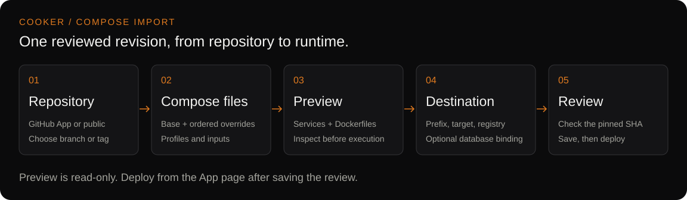

# Cooker user guide

Cooker provides visual pipelines, reviewed application deployments, and a shared
view of selected hosting projects. Its Go server serves the API and React frontend
on port 8080 by default. The isolated backend candidate includes further Git and
registry work; check the [current status](../backend/current-status-2026-10-02.md)
for the distinction between verified local code and the running UAT build.

## Where to start

| You want to… | Read |
|---|---|
| Explore Cooker locally or start a real UAT stack | [Quickstart](getting-started/quickstart.md) |
| Import Compose from GitHub and deploy a reviewed revision | [GitHub Compose deployment](../guides/GITHUB-COMPOSE-DEPLOYMENT.md) |
| Understand Apps, Pipelines and Environments | [Product concepts](concepts/apps.md) |
| Save and reopen Compose stacks | [Compose library and registries](guides/compose-library.md) |
| Author a custom stage graph | [Your first pipeline](guides/first-pipeline.md) |
| Review branch/tag deployment through a native DAG | [Connected Git pipelines](guides/native-git-pipelines.md) |
| Grant and select container registry credentials | [Registry access](guides/registries.md) |
| Configure targets | [Hosts and targets](concepts/hosts-and-targets.md) |
| Prepare a production installation | [Helm install](getting-started/helm-install.md) and [Auth & RBAC](operations/auth-and-rbac.md) |
| Configure logs, metrics and tracing | [Observability](operations/observability.md) |
| Diagnose a problem | [Troubleshooting](operations/troubleshooting.md) |

## Current App contract

The import wizard discovers Compose files and Dockerfiles before deployment,
resolves ordered overrides/profiles, and saves a full Git SHA with your prefix and
bindings. Deployment starts from the App page. Reviewed Compose Apps require
explicit reinspection for source updates and use manual deployment.

The backend candidate supports the BuildKit builder with the Crane pusher for
source builds. Docker builder with Docker pusher remains a development option;
production validation rejects that pair. Stage outputs must be enabled for the
immutable image handoff. See the [build handoff](../backend/buildkit-handoff.md)
for configuration and the limits of its recorded acceptance.

Scoped registry deployment currently supports Cooker-local Docker and Compose.
Connected Git native pipelines use Docker deployment stages. Image-only plans,
standalone image builds and other configured adapters have separate checks; their
presence does not prove that a particular cloud or Compose feature is supported.

For ECS plus Cloud SQL, provision infrastructure, database access and networking
separately. Cooker maps an existing external database into the application's
Environment keys; live cross-cloud acceptance remains to be completed.

## Documentation scope

This is the user/operator guide. Contributor architecture lives in the
[system design](../system-design/README.md) and [execution reference](../reference/github-compose-architecture.md).
See [SECURITY.md](../../SECURITY.md) for vulnerability reporting and security
policy. Cooker is pre-1.0; check the [changelog](../../CHANGELOG.md) before upgrading
and use the [UAT runbook](../guides/UAT.md) to accept the behavior you depend on.
